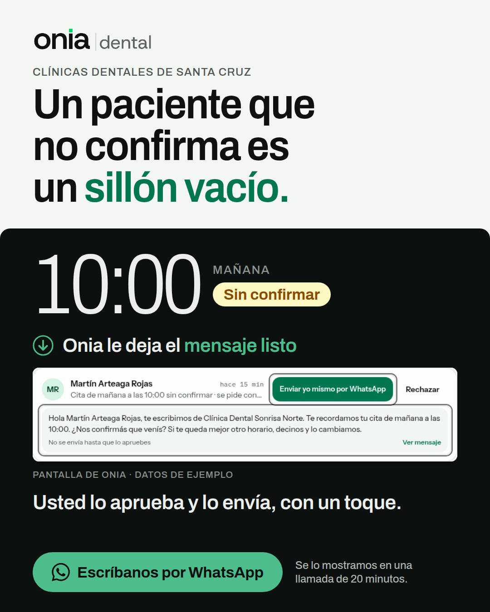
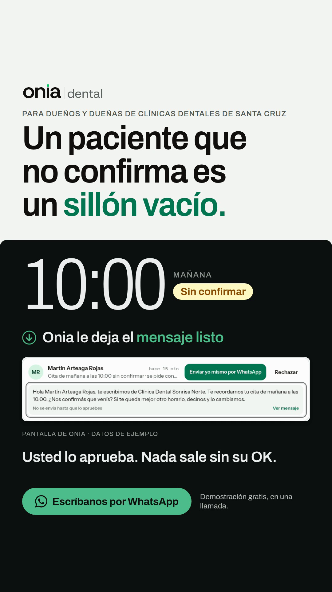

# LISTA PARA MOSTRAR: campaña prueba 1

> **11-oct-2026 · Ventas y pauta.** Encargo de la madre v4. **No se creó nada en Meta, no se gastó nada, no se contactó a nadie.**
> **El presupuesto (US$ 56 · 14 días · tope Bs 750) está SIN aprobar:** lo aprueba Sergio Urcullo por escrito, en la sesión que crea y enciende.
> Qué está listo y qué no, en una línea: **dos de los tres creativos están renderizados y mirados; el tercero (el selfie) lo graba Sergio Urcullo. La campaña está especificada paso a paso. El go/no-go del 13-oct sigue en NO-GO: 0 de 9 filas en ✅.**
> Fuentes: `CAMPANA-1-LISTA-PARA-CREAR.json` (spec ejecutable), `ONIA_ADQUISICION_Y_PAUTA.md` §5.7, §5.10, §5.11, `research/competencia/anuncios/{CAPTURAS-HECHAS.md,fichas/}`, `ONIA_CATALOGO_DE_VENTA.md` §4, §7, §8, `ONIA_PROMESA_VS_PRODUCTO.md`.
> **⚠️ 11-oct, noche: el §1 (los 3 creativos A1-E, A1-V, A1-S) lo REEMPLAZA la prueba 1 v2.** Sergio Urcullo vio A1-E y dijo «ese ad está horrible, mejoralos»: era una losa de texto sin persona. Los 5 creativos nuevos copian, zona por zona, los anuncios que más días llevan al aire y están en `prueba1-v2/LISTA-PARA-MOSTRAR-V2.md`. Lo demás de esta lista (público, presupuesto, cortes, go/no-go, día del sí) sigue vigente; `CAMPANA-1-LISTA-PARA-CREAR.json` sigue describiendo A1 hasta que Sergio Urcullo elija cuáles de las 5 entran.

---

## 1. Los 3 creativos (de usted, para clínicas dentales de Santa Cruz)

### 1.1 Por qué estos tres formatos

El concepto es uno solo, *«el paciente de mañana que no confirmó»*; cambia **solo el formato**, para no mezclar tres ideas. **No es una prueba A/B**: Meta reparte el presupuesto según rinde cada copia y con US$ 56 no alcanza para comparar con estadística (`ONIA_ADQUISICION_Y_PAUTA.md` §5.3 y §5.6.1). Lo que se mira es si las piezas traen dueños de clínica.
Los formatos salen de las 18 capturas de la Biblioteca que sí abrieron (`CAPTURAS-HECHAS.md`, 1-oct), contados **por anunciante distinto** (las copias de un mismo anunciante inflan el conteo) y con los días al aire del corte del 10-oct:

| Formato | Anunciantes | Anuncios | Los más largos al aire (días al 10-oct) | Copia de Onia |
|---|---|---|---|---|
| **Persona a cámara** (testimonio, selfie, UGC, presentadora) | **4**: Doctocliq, CitaPro, Dentalink, Calendico (**5** con Dt.Dental, capturado en la ronda 2: `FORMATOS-QUE-SOSTIENEN.md` F1) | 6 (+ el selfie de Dt.Dental) | Dt.Dental selfie `1064012876297472` **102 d** · CitaPro presentadora `1880949689530541` **86 d** · Doctocliq testimonios `895549733230235` 57 d y `1684698082830679` 54 d | **A1-S** selfie |
| **Imagen**: titular de dolor + persona o pantalla + un botón | **3**: CitaPro, NativeCode, Ultra Pack | 5 | CitaPro `2253602242100999` **65 d** (es la foto de una profesional con burbujas de WhatsApp: **tiene persona**) · NativeCode, la única con pantalla de software y botón de WhatsApp: empezó el 1-oct, **≤ 10 d** | **A1-E** imagen (solo pantalla, sin persona) |
| **Video corto de una idea, ≤ 30 s** | 2: Doctocliq y Medizona (con escenas hechas con IA) | 6 | Doctocliq micro-video de 10 s `1952892278698712` **79 d** (el de 30 s más antiguo: `1014591764512827`, 85 d) | **A1-V** video de 11 s |

**Lectura honesta:**
- **El tercer formato es el más flojo por conteo.** Por número de anunciantes, el tercero son las escenas hechas con IA (Doctocliq y Medizona); Onia **no** las hace: un odontólogo o un cliente inventado es lo que `CLAUDE.md` prohíbe y un presentador de IA solo va si Sergio Urcullo lo pide y con costo cotizado. En su lugar entra el video corto **con la pantalla real**, que no inventa a nadie.
- **Las dos copias que ya existen (imagen y video con la pantalla, sin persona) no tienen un precedente que haya durado:** la única imagen con pantalla y botón de WhatsApp es de NativeCode y tiene ≤ 10 d; el video corto que dura es una escena hecha con IA. **El formato con más precedentes en la muestra es la persona a cámara** (4 anunciantes contra 3 contra 2; 5 con Dt.Dental), que es justo el que depende de Sergio Urcullo. Es poco para afirmar «más respaldo»: la muestra no es azar, el anuncio de 102 d trata un tema de norma legal que Onia no copia, y el inicio que muestra la Biblioteca puede ser una reactivación.
- **La muestra no es azar:** 22 anuncios elegidos el 1-oct, 8 de Doctocliq. Y **los días son antigüedad, no rendimiento** (un anuncio puede durar por inercia). El conector de la Biblioteca no entrega formato, texto principal ni botón de los 271 anuncios del estudio del 10-oct, así que el formato **no se puede contar sobre ellos**: solo sobre estas capturas.
- **Solo NativeCode manda a WhatsApp** (imágenes); los que duran van a una demo o a una cuenta gratis. Que el destino sea WhatsApp es una **hipótesis de Onia**, no un dato de la competencia (`ONIA_ADQUISICION_Y_PAUTA.md` §5.10, punto 3).

### 1.2 Resumen

| | Formato | Código (texto precargado) | Estado el 11-oct | Qué falta |
|---|---|---|---|---|
| **A1-E** | Imagen 4:5 (Feed) + 9:16 (Historias y Reels de Facebook) | `D1` | Renderizada y mirada. **Hoy se rehízo sin el botón «Enviar yo mismo por WhatsApp»** (G-03 está a medias) | Recaptura con la cuenta demo (misma persona en agenda y Pendientes) |
| **A1-V** | Video 9:16 de 11 s, sin audio | `D2` | Renderizado y mirado (cuadros 0,3 s · 5,5 s · 7,5 s · portada) | Lo mismo |
| **A1-S** | Selfie de 25 s de Sergio Urcullo con la pantalla | `D3` | **Guion listo, sin grabar** | Lo graba y lo autoriza Sergio Urcullo (su cara y su voz) |

**Texto principal, titular y botón: los mismos en los tres** (es lo que se mantiene fijo para que la prueba compare formatos). Sale del brief `onia-platform-dental-meta-a1v5-las-diez.json` palabra por palabra y un test lo exige:

```
Para dueños y dueñas de clínicas dentales de Santa Cruz.

Un paciente que no confirma es una silla que puede quedar vacía, y el alquiler, la asistente y su hora se pagan igual.

Onia es un sistema de gestión para clínicas dentales: agenda, ficha con odontograma, tratamientos y cobros. Cada mañana le deja anotado a quién escribirle, con el mensaje listo, y nada sale sin que usted lo apruebe.

Escríbanos por WhatsApp y pida su demostración gratis.
```

- **Titular del anuncio** (el campo junto al botón): `Pida su demostración gratis`
- **Botón de Meta:** «Enviar mensaje de WhatsApp» (`WHATSAPP_MESSAGE`). **Un solo CTA, un solo destino.**
- **Texto precargado del chat** (uno por copia; el bot lee letra + número, por eso no se usa «D1V»):
  - A1-E: `Hola, vi el anuncio de Onia (D1). Tengo una clínica dental.`
  - A1-V: `Hola, vi el anuncio de Onia (D2). Tengo una clínica dental.`
  - A1-S: `Hola, vi el anuncio de Onia (D3). Tengo una clínica dental.`
- **El filtro está en la primera línea** («Para dueños y dueñas de clínicas dentales de Santa Cruz»): el cliente ideal es una fracción mínima del público alcanzable y la segmentación no lo separa (§5.2); la que filtra es la pieza.
- **Ningún texto dice:** precio, «con IA» junto a «a quién escribirle», cifras o testimonios, factura SIAT, WhatsApp automático, «con un toque», tratamiento a medias, minutos de la llamada (el bot dice 30 y la agenda 20: L-04), «clínica de ejemplo» (L-05 ❌), competidores.

### 1.3 A1-E · «Las 10:00» · imagen



- **Brief:** `onia-platform-dental-meta-a1v5-las-diez.json` → `carousels/out/ads/onia-platform-dental-meta-a1v5-las-diez/{feed,story}.png` (1080×1350 y 1080×1920).
- **Lo que dice la imagen:** «Para dueños y dueñas de clínicas dentales de Santa Cruz» · **«Un paciente que no confirma es un sillón vacío.»** · «10:00 · Mañana · Sin confirmar» · «Onia le deja el mensaje listo» · la pantalla · «Usted lo aprueba. Nada sale sin su OK.» · «Escríbanos por WhatsApp» · «Demostración gratis, en una llamada.»
- **Captura real que lleva:** el recorte del mensaje que el agente «Confirma citas» deja listo en **Pendientes** (`briefs/assets/onia-1.0-dental-ads/candidato-20260930/pendientes-confirmador.png`), con la leyenda «Pantalla de Onia · datos de ejemplo».
  - **Por qué esa y no otra:** el catálogo marca Agentes («Pendientes») como ✅ *sale* (§4: corren solos todos los días) y su §8 frase 3 es exactamente lo que la pieza dice («Onia revisa su agenda y le deja anotado a quién escribirle, con el mensaje listo; nada sale sin que usted lo apruebe», **sin IA: son reglas**).
  - **Qué no muestra:** el botón «Enviar yo mismo por WhatsApp» (G-03 🟡: el catálogo §7 no deja prometer el envío por WhatsApp). **Hoy se recortó** para que la pieza no lo traiga.
  - **Lo que sigue siendo provisorio:** la captura es del candidato del 30-sep, no de producción, y las filas B-02, G-01, G-06 y G-11 siguen ⬜ hasta mirarlas con la cuenta demo. **Dentro de la pantalla hay voseo y tuteo:** el mensaje al paciente («confirmás», «decinos», «tu cita», «te queda») y la línea «No se envía hasta que lo apruebes», que le habla al dueño a dos líneas de «Usted lo aprueba». Es el texto por defecto del producto, no el tono de Onia. Sergio Urcullo confirma que es intencional, o se cambia la plantilla de la cuenta demo antes de recapturar.
- **Estado:** renderizada y mirada a 1080 px (feed e historia) el 11-oct.
- **Precedente del formato:** CitaPro `2253602242100999` (65 d) usa titular de dolor + una persona + un botón (la nuestra no tiene persona); NativeCode usa titular de dolor + pantalla + botón de WhatsApp, pero empezó el 1-oct. **Esta copia no tiene un precedente que haya durado.**

### 1.4 A1-V · «Las 10:00» · video de 11 s



- **Archivo:** `carousels/out/ads/onia-platform-dental-meta-a1v5-las-diez/onia-platform-dental-meta-a1v5-las-diez.mp4` (1080×1920, 11 s, sin audio) y portada `video-thumb.png`. Variante de 10 s con «¿Quién de mañana no confirmó?»: `…a1v5-micro-10s/…mp4` (**no entra en la prueba 1**: sería otra variable).
- **Guion por tiempos:** 0-1,4 s el titular «Un paciente que no confirma es un sillón vacío.» → 1,4 s «10:00 · Mañana · Sin confirmar» → 3,0 s «Onia le deja el mensaje listo» → 3,4 s la pantalla del mensaje → 7,0 s «Usted lo aprueba. Nada sale sin su OK.» → 8,4 s el botón «Escríbanos por WhatsApp». **El titular está desde el primer cuadro:** sin audio, es lo único que se lee de entrada.
- **Captura real que lleva:** la misma que A1-E (mismo recorte, sin el botón de envío).
- **Estado:** renderizado y mirado el 11-oct (cuadros 0,3 s, 5,5 s, 7,5 s y último).
- **Precedente del formato:** Doctocliq, micro-video de 10 s con una sola frase y tarjeta final (`1952892278698712`, 79 d). **Diferencia con ese anuncio:** el nuestro es la pantalla real, no una escena generada.

### 1.5 A1-S · «Lo que Onia le deja listo cada mañana» · selfie de 25 s

- **Formato:** Sergio Urcullo a cámara, celular vertical, luz de ventana, **sin música ni producción**, subtítulos en chip, con la pantalla de **Pendientes** de la cuenta demo (el recorte del mensaje; **sin enseñar ni tocar el botón de envío** mientras G-03 esté en 🟡).
- **Guion (cada frase sale del catálogo §8; es la corrección del guion de `FORMATOS-QUE-SOSTIENEN.md` F1, que decía «20 minutos» y «con su agenda»):**
  1. (0-3 s) «Dueño o dueña de una clínica dental: ¿quién de mañana no confirmó?»
  2. (3-14 s) *(muestra Pendientes)* «Cada mañana Onia revisa su agenda y le deja anotado a quién escribirle, con el mensaje listo.»
  3. (14-19 s) «Usted lo aprueba. Nada sale sin su OK.»
  4. (19-25 s) «Si quiere verlo, pida su demostración gratis. Escríbanos por WhatsApp.»
- **No dice:** minutos de la llamada (L-04), «con su agenda» ni «clínica de ejemplo» (L-05 ❌), «con IA», cifras, «lo envía con un toque» (G-03), tratamiento a medias.
- **Texto principal, titular, botón:** los de §1.2. Texto precargado: `Hola, vi el anuncio de Onia (D3). Tengo una clínica dental.`
- **Estado: sin grabar y con una dependencia:** muestra Pendientes de la **cuenta demo, que todavía no existe** (fila 2 del go/no-go). Es su cara y su voz en un anuncio: **lo graba y lo autoriza él** (`CLAUDE.md`, «Qué se publica sin preguntar»), y `CLAUDE.md` pide además el OK de **Leslie Mercado Moreno** para subir su cara o su voz a servicios externos. Con 25 s y una toma bastan; la edición (subtítulos y portada) no tiene gasto de IA (skills `ver-videos` y `editor-videos`).
- **Precedente del formato:** Dt.Dental, selfie de una persona sentada a cámara (`1064012876297472`, **102 d**, el más antiguo de los que se sabe que son persona a cámara) y CitaPro con presentadora (`1880949689530541`, 86 d). **Lo que Onia no copia:** el tema (una obligación legal con fecha; Onia no tiene una que anunciar) ni el «No es X, no es Y» cuando promete lo que no hay.
- **Es opcional para la primera tanda** (`ONIA_ADQUISICION_Y_PAUTA.md` §5.10). **Decisión que necesita de Sergio Urcullo antes de que se cree la campaña: ¿graba sí o no?** Si graba **antes** del OK (y con la demo lista), entra con las otras dos desde el día 1. Si no, **la campaña sale con A1-E y A1-V y el selfie no se agrega durante la prueba** (agregar un anuncio es una edición significativa: reinicia el aprendizaje y abre otra revisión de ~24 h, ayuda oficial de Meta); queda para la segunda tanda, pagada con plata de un cliente (§5.7).

---

## 2. Público, presupuesto y métrica de corte

### 2.1 Público (un solo conjunto: `Dental SCZ · 25+ · WhatsApp`)

| | |
|---|---|
| Dónde | Santa Cruz de la Sierra, radio de 25 km desde (-17,7833; -63,1821). **«Llegar a más personas» apagado** |
| Quién | **25 años o más** (es el único control: nadie menor de 25) + Advantage+ con sugerencias (odontología, administradores de páginas) |
| Dónde sale | **Solo Facebook** (Feed, Historias y Reels de Facebook): ONIA Ads **no tiene Instagram vinculado**. Vincular uno es decisión de Sergio Urcullo |
| No se hace | Exclusiones por interés (no existen desde el 31-mar-2025) · público personalizado con pocos teléfonos (Meta pide ≥ 1.000) · lookalike · remarketing pago |
| El filtro real | La primera línea de la pieza y los tres botones del chat, no la segmentación |
| Riesgo | Un anuncio que dice «clínica dental» trae **pacientes** que buscan turno; el bot los despide con cortesía («por acá no damos turnos») |

### 2.2 Presupuesto (SIN aprobar)

| | |
|---|---|
| Total | **US$ 56** de presupuesto total de la campaña (5.600 centavos), **14 días**. Es el **techo de gasto de la campaña** (presupuesto total): lo que fija es el monto, no el ritmo |
| Promedio | US$ 4 por día. **Es un promedio, no un tope diario**: con presupuesto total Meta reparte libre entre los días |
| En bolivianos | Depende de lo que cobre el banco: **Bs 637** a 11,37 · **Bs 666** a 11,89 · **Bs 750** a 13,4 · **Bs 840** a 15 |
| «Tope Bs 750» | **No lo apaga nadie solo.** Es una regla manual: si el cobro acumulado llega a Bs 750 antes del día 14, se apaga ese día (a 15, a mitad del día 13: Bs 750 son US$ 50 de US$ 56). Meta no acepta un límite de gasto de campaña menor a US$ 100 |
| Techo del negocio | Bs 1.400 en total: al llegar se apaga todo |
| Estructura | Una campaña (Clientes potenciales, mensajes de WhatsApp), un conjunto, **dos o tres anuncios** (§1.5). Presupuesto de la campaña, no por anuncio: Meta empuja al que rinde, y que uno reciba pocas impresiones **no es un veredicto** |
| Se crea | Como **borrador** (en este conector crear no deja nada en pausa: deja borradores y `ads_activate_entity` los publica gastando). Encender es el último paso |
| Quién paga | La tarjeta la pone Sergio Urcullo (y Leslie Mercado Moreno si es de la razón social) |

### 2.3 La métrica de corte

**La que decide: costo por conversación ≤ Bs 40 el día 7, con al menos 1 conversación de dueño de clínica** (§5.7: el costo es el de todas las conversaciones; lo de dueño es un mínimo de 1, no el divisor). El código D1/D2/D3 dice **de qué anuncio** vino cada conversación (se busca en Chatwoot; el `referral` se pierde, §5.5); **quién es dueño** lo dice el chat: eligió «Tengo una clínica y quiero ver cómo funciona» o pasó las preguntas. Cualquier paciente que toque el botón manda «Tengo una clínica dental»: el código solo no filtra.

| Día | Corta si | Qué se hace | Con qué plata se mide |
|---|---|---|---|
| **3** | 0 conversaciones **o** CTR < 0,8 % | **Primero se descarta un problema de entrega** (anuncio aprobado y con impresiones, el chat abre con el código, el bot contesta): con ≈ US$ 4 por copia, cero conversaciones suele ser poca entrega, no mala pieza. **Solo lo que no trae nada se pausa** (`ads_update_entity`, `PAUSED`): no se cambia la pieza ni el público ni se agrega otra, que son ediciones significativas. Que pausar un anuncio no reinicia el aprendizaje es una **inferencia**: la ayuda de Meta no lo dice | ≈ US$ 12 entre todas las copias si Meta reparte parejo (puede no repartir parejo) |
| **7** | Costo por conversación > Bs 40 **o** 0 conversaciones de dueños | Se corta | ≈ US$ 28 (Bs 375 a 13,4): a Bs 40 son ~9 conversaciones, y con el cliente ideal en ≲ 0,1 % del público alcanzable **es probable que pocas sean de dueños**: por eso el piso es 1 |
| **14** | 0 demos **o** costo por demo > Bs 390 | Se corta | US$ 56 |

- **Bs 40 por conversación y Bs 390 por demo son supuestos de Onia**: Bs 1.570 de costo máximo por cliente × 25 % de cierre × 10 % de conversación a demo. Meta no da referencias sin gasto previo («No industry benchmark data»); los costos reales por conversación en Bolivia **no se conocen hasta la semana 1**.
- **Seguir** = una segunda tanda igual pagada **solo con plata de un cliente que ya pagó**, nunca con la reserva.
- El presupuesto no se sube más de 20 % por paso (regla propia: Meta no da umbral).
- Se mira además, sin umbral propio hasta la semana 1: conversaciones de dueños ÷ conversaciones, frecuencia, y en los videos reproducciones de 3 s ÷ impresiones.

---

## 3. Go/no-go del martes 13-oct (medido el 11-oct, solo lectura)

**Regla: no se enciende con una fila en ❌.** Hoy: **NO-GO. 0 de 9 filas en ✅.** Para encender el 16-oct, el OK escrito conviene el 14-oct (el 15 deja menos de 24 h para la revisión de Meta antes de las 00:00 de arranque); el resto, el 13-oct.

| # | Condición | Estado 11-oct | Quién la destraba | Cómo / cuánto |
|---|---|---|---|---|
| 1 | Las filas **B-01, B-02, C-02, D-01, E-01, G-01, G-04, G-06** (lo que dice el texto: agenda, ficha con odontograma, tratamientos, cobros, estado de confirmación, «nada sale sin su OK», «cada mañana») y **G-11, L-05** (la demostración de la llamada; el texto ya no promete IA ni «clínica de ejemplo») en ✅, y la web sin lo que el catálogo no deja | ❌ ninguna verificada: falta la cuenta demo. (La madre avisó que F1 + #142 + #139 salían a producción el 10-oct; desde la nube no se puede mirar) | **Plataforma**, con la cuenta de prueba. **Sergio Urcullo solo en L-04** (20 contra 30 minutos) | Plataforma mira cada fila con la cuenta. Si una queda en 🟡 o ❌, la fecha se corre |
| 2 | Cuenta demo con datos y capturas nuevas, re-renderizadas | ❌ | **Plataforma** deja la demo y las capturas; **Ventas y pauta** re-renderiza y mira | Un comando por pieza (`grabar-captura.mjs` + `anuncio-render.js`/`anuncio-video.js`); ½ hora. Sin ella las dos piezas siguen provisorias |
| 3 | Medio de pago en ONIA Ads | ❌ **medido hoy: `has_payment_method: false`** (cuenta `1073680778314945`) | **Sergio Urcullo** (y Leslie Mercado Moreno si la tarjeta es de la razón social) | Poner la tarjeta en el Administrador. La cuenta personal `679613631427810` **no** se usa |
| 4 | Número del bot (+591 75414930) vinculado a la página «Onia» | ⬜ el conector no lo ve. La página `1140384625819526` sí está en la lista del negocio | **La madre** lo lee en Business Manager desde la PC; **Sergio Urcullo** si falta vincularlo (el código llega a su teléfono) | Leerlo no cambia nada |
| 5 | Respuesta del bot a la pauta **publicada** y probada con un teléfono ajeno | ❌ texto escrito y de usted (`knowledge.onia.json` 2026-10-03.2, lee D1, D2, D3 y D5); sin verificar que producción lo sirva | **Sergio Urcullo**: la firma (una palabra, `FIRMA_HUMANA`) y 2 minutos con un teléfono que no sea el de Onia | Dos mensajes con el texto exacto de cada precargado, **mirando** la respuesta y el aviso «Origen: anuncio-D1» |
| 6 | Quién contesta y en cuánto; agenda de `/llamada`; duración de la llamada (20 o 30) | ❌ y hay un choque: el bot ofrece 30 min y los textos dicen 20 (L-04 🟡) | **Sergio Urcullo** | Recomendación: contesta él, el mismo día hábil y **antes de 24 h** (abre la ventana gratis de 72 h); el bot atiende al instante y le avisa |
| 7 | Tipo de cambio del banco | ❌ sin medir | **Sergio Urcullo** lo lee en el extracto; **no bloquea**: lo cubre la regla manual de §2.2 dentro del OK | Va dentro de la fila 9 |
| 8 | Píxel visto en «Probar eventos» | ⏳ «ONIA Web» `1012611478191231` activo; **disparó el 10-oct 18:21 (UTC-7)** | La madre o Plataforma desde la PC | **No bloquea la prueba 1**: el clic a WhatsApp no depende del píxel. Solo bloquea la web como destino |
| 9 | **OK explícito de gasto: «US$ 56, 14 días, tope Bs 750»** | ❌ no hay | **Sergio Urcullo**, **escrito en la sesión que crea y enciende** | Un mensaje de otra sesión, de la madre o un documento no lo reemplaza |

**Condiciones que la tabla original no tenía (la revisión del 10-oct las sumó al JSON de la campaña):**

| Condición | Estado 11-oct | Quién |
|---|---|---|
| Instagram vinculado a ONIA Ads | ❌ `ads_get_ig_accounts` → `[]`: sin él los US$ 56 corren solo por Facebook | **Sergio Urcullo**: o lo vincula, o acepta Facebook solo |
| Canales 1 y 2 contactados (`ONIA_PLAN_1.0_Y_CAJA.md` §3) | ❌ frenado el 8-oct; su aprobación del 10-oct cubre el texto, no el contacto | **Sergio Urcullo** |
| Declaración de IA del creativo (`self_ai_disclosure`) | Sin decidir; **no se puede cambiar después de crear el creativo**. Las capturas son reales y el texto sale de código | **Sergio Urcullo** |
| Mensaje de bienvenida con los **tres botones** del chat | Sin configurar: el conector no lo expone, se hace **a mano** en el Administrador (anuncio → mensaje de bienvenida) y es lo que filtra a los dueños (§2.1) | **La madre**, antes de encender; texto en `CAMPANA-1-LISTA-PARA-CREAR.json` `bienvenida` |
| Selfie A1-S grabado | Sin grabar (§1.5) | **Sergio Urcullo**: sí o no |
| Plantilla en voseo dentro de la captura | Sin decidir (§1.3) | **Sergio Urcullo** / Plataforma |

**Medido hoy, sin cambiar nada (conector `Meta_ads`, solo lectura):** ONIA Ads ACTIVE, USD, mínimo diario US$ 1, sin medio de pago · página «Onia» disponible · sin Instagram · píxel activo · **0 campañas y 0 borradores**.

### Lo que Ventas y pauta ya cerró (no depende de nadie)
Texto de usted revisado contra el catálogo (§7 y §8) y el detector de promesas, 0 hallazgos · copia sin «con un toque» (G-03) · **imagen y videos de A1 sin el botón de envío (hoy)** · guion del selfie corregido · público, presupuesto y cortes en el JSON ejecutable · cinco preguntas de calificación y respuesta del bot de usted · estudio de la Biblioteca (271 anuncios de software, 417 de clínicas bolivianas, 18 fichas) y de la ayuda oficial de Meta Ads.

### Lo mínimo que se le pide a Sergio Urcullo (todo junto, no de a uno)
1. Poner la tarjeta en ONIA Ads.
2. Escribir **«US$ 56, 14 días, tope Bs 750»** en la sesión que crea y enciende.
3. Firmar la respuesta del bot y probarla 2 minutos con otro teléfono.
4. Contesta él en menos de 24 h: sí o no. Llamada de 20 o 30 minutos.
5. Instagram: sí o no. Declaración de IA: sí o no.
6. Selfie de 25 s: graba sí o no (y la plantilla en voseo de la captura: intencional o se cambia).
7. Canales 1 y 2: descongelar el contacto o mover la fecha.

---

## 4. El día del sí (secuencia exacta, ya escrita)

La spec con los parámetros del conector está en `CAMPANA-1-LISTA-PARA-CREAR.json`; un test la cruza con el brief, el bot y el catálogo. En resumen, **la madre** (que tiene el login y el sí escrito):
1. **Preflight (lectura):** tarjeta `true`, página en la lista del negocio, 0 borradores, píxel activo.
2. **Crear en borrador:** campaña (`OUTCOME_LEADS`, presupuesto total 5.600 centavos, inicio y fin con -04:00) → conjunto (conversaciones de WhatsApp, Santa Cruz 25 km, 25+) → subir imágenes y video → creativos con el texto, el titular y el precargado de §1.2 → anuncios.
3. **Mirar la vista previa** de cada anuncio en Feed, Historias y Reels: el botón dice «Enviar mensaje de WhatsApp» y abre el chat con el código. Si el conector no respeta el texto precargado, se pone a mano en «Mensaje de bienvenida» **antes de publicar**: sin código se pierde la atribución. **En el mismo lugar se configuran a mano los tres botones del chat** (§3): son el filtro real.
4. **Encender** (`ads_activate_entity`) solo con las filas 1-6 y 9 y las condiciones de arriba en ✅; esperar 2 minutos y verificar `ACTIVE` en **los cuatro niveles**.
5. **A las 24 h:** ¿llegó un mensaje?, ¿con el código?, ¿contestó el bot?, ¿le avisó a Sergio Urcullo? Los ids van al handoff `mercado-y-pauta.md`.

---

## 5. Lo que esta lista no prueba

- **Que A1 sea el mejor concepto.** La Biblioteca no ordena las piezas con fuerza; A1 va primero porque es el plan de la prueba y está lista. N1, N2 y A2 esperan sus tandas (§5.11).
- **Que el formato elegido sea el que rinde.** Los formatos salen de una muestra de 18 anuncios y de la antigüedad al aire, no de resultados.
- **Cuánto cuesta una conversación en Bolivia.** Supuesto hasta la semana 1. Con US$ 56 no alcanza para comparar copias con estadística: la pregunta que sí se contesta es **¿la pieza y los tres botones traen dueños de clínica?**
- **El costo de los mensajes de WhatsApp.** La ventana gratis de 72 h y el precio del mensaje de servicio **no están reconciliados** con §5.5: se mira en el WhatsApp Manager de Onia (Insights) cuando haya conversaciones.
