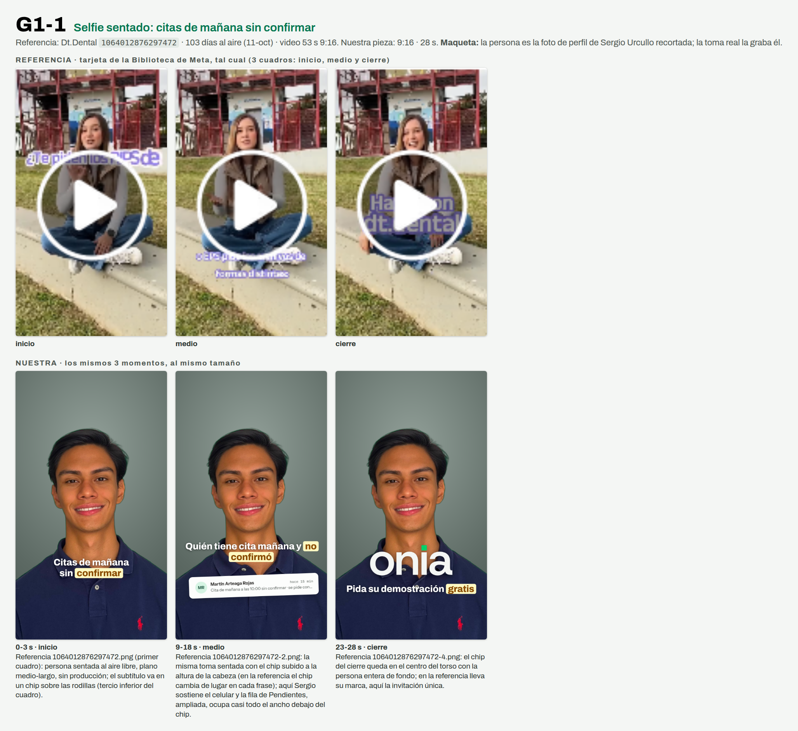

# G1-1 · Selfie sentado: citas de mañana sin confirmar

> **Prueba 1 v2 · 11-oct-2026 · Ventas y pauta.** Nada se creó en Meta, cero gasto, nadie contactado. Generado por `replica-hojas.mjs` desde `G1-1.json`: se edita el brief, no esta hoja.



**Referencia:** Dt.Dental `1064012876297472` · **103 días al aire** al 11-oct (antigüedad, no rendimiento) · video 53 s 9:16. Ficha zona por zona: `research/competencia/anuncios/replicas/REFERENCIAS-GRUPO-1.md` §R1.
**Nuestra pieza:** 9:16 · 28 s · código del chat `D7` · imágenes en `carousels/out/ads/prueba1-v2/G1-1/`.

## Zona por zona

| Zona | Referencia (lo que se ve en su captura) | Nuestra |
|---|---|---|
| **Persona** | Joven de pelo largo sentada afuera, plano entero (cabeza a pies), cara en el tercio superior (17-75 % del alto), cámara fija, mira a cámara y gesticula. | Sergio Urcullo sentado, ropa de calle, misma toma fija. **Maqueta:** busto recortado; la toma real es plano medio-largo. |
| **Subtítulo** | 4-5 palabras por línea, violeta con contorno blanco; cambia de altura (33 % → 69-75 % → 47-57 %). | Blanco con sombra y UNA palabra en el chip amarillo del «Pendiente» de la app; también cambia de altura (69 % → 63 % → 79 %). |
| **Producto** | Ni logo ni pantalla en ningún momento visto. | **Cambia a propósito:** la fila real de Pendientes en el medio (regla «producto visible o no sale»). |
| **Marca / cierre** | «dt.dental» enorme (47-57 %) dentro del último subtítulo; sin tarjeta final. | «onia» enorme sobre el torso + «Pida su demostración gratis»; sin tarjeta final. |
| **CTA** | Botón de la tarjeta «Ir al perfil de Instagram». | Botón de Meta «Enviar mensaje de WhatsApp». Ninguna referencia va a WhatsApp: es hipótesis de Onia (ADQ §5.10). |
| **Largo** | 53 s. | 28 s. |

## Gancho (checklist de §9.3)

- **Texto en pantalla:** «Citas de mañana / sin confirmar» (2 líneas de 15 y 13 caracteres, sin punto final, un énfasis).
- **Se ve (cuadro 0):** Sergio Urcullo sentado en un banco o escalón al aire libre, plano medio-largo, mirando a cámara con el celular en la mano apoyada en la rodilla; el gancho va en un chip sobre las rodillas.
- **Se dice:** «¿Sabe si vendrán todos los de mañana?»
- **Alinean sin repetirse:** La imagen es alguien con el celular que va a contar algo de su agenda, el texto nombra el problema (citas de mañana sin confirmar) y la voz lo vuelve duda (si vendrán todos): cada uno dice una parte distinta de lo mismo y ninguno copia al otro.
- **Alternativa:** «Mañana hay citas / en duda»

## Guion

| Tramo | Toma | Se dice | En pantalla |
|---|---|---|---|
| 0-3 s | Selfie sentado, plano medio-largo, celular en la mano apoyada en la rodilla | ¿Sabe si vendrán todos los de mañana? | Gancho en chip, tercio inferior: Citas de mañana / sin *confirmar* |
| 3-9 s | Misma toma; el chip sube a la altura de la cabeza | Soy Sergio Urcullo, de Onia. Esto es lo que le deja cada mañana. | Subtítulo en chip: Soy Sergio Urcullo, de *Onia* |
| 9-18 s | Sergio levanta el celular; la fila de Pendientes ampliada ocupa casi todo el ancho | Onia revisa su agenda cada mañana. Le deja anotado quién tiene cita mañana y no confirmó. Y el mensaje, listo. | Fila cita-manana legible a 390 px de ancho (texto ampliado, nunca el mensaje ni el botón de envío) con la leyenda «Pantalla de Onia · datos de ejemplo»; subtítulo: Quién tiene cita mañana y *no confirmó* |
| 18-23 s | Vuelve la selfie; el chip va al centro | Usted lo aprueba. Nada sale sin su OK. | Subtítulo en chip: Usted lo *aprueba* |
| 23-28 s | Selfie, mirando a cámara | Escríbanos por WhatsApp y pida su demostración gratis. | Chip centrado: Pida su demostración *gratis* |

## El anuncio en Meta

Texto principal (la primera línea es el filtro):

```
Para dueños y dueñas de clínicas dentales de Santa Cruz.
La víspera de cada cita es una duda: ¿vendrá o no? Mientras tanto, el sillón y el equipo ya están pagados.
Onia es un sistema de gestión para clínicas dentales: en Pendientes, cada mañana le deja anotado quién tiene cita mañana y no confirmó, con el mensaje listo.
Nada sale sin que usted lo apruebe.
Escríbanos por WhatsApp y pida su demostración gratis.
```

- **Titular:** `Pida su demostración gratis` · **Botón:** «Enviar mensaje de WhatsApp» (un solo llamado, un solo destino) · **Texto precargado:** `Hola, vi el anuncio de Onia (D7). Tengo una clínica dental.`

## Modelar, no clonar

- **Se queda:** Una persona sentada hablándole a cámara sin producción, subtítulos grandes que cambian de altura y el nombre de la marca grande al final.
- **Cambia:** El tema (una norma colombiana de reporte: Onia no tiene una obligación que anunciar) por el dolor de la clínica dental; el mecanismo (Pendientes); el nombre y los colores (marca de la web, no violeta). Suma la pantalla real, que la referencia no tiene.

## Promesas: cada frase atada a su fila

| Frase | Fuente y estado | Filas que tienen que estar en ✅ |
|---|---|---|
| Cada mañana Onia revisa su agenda | CAT §8 frase 3 · ⬜ sin verificar: corre solo, falta el log del VPS | G-04 |
| Le deja anotado quién tiene cita mañana y no confirmó | CAT §8 frase 3 (son reglas fijas) · ⬜ sin verificar: falta la cuenta demo | G-06, B-02 |
| Y el mensaje, listo | CAT §8 frase 3 · ⬜ sin verificar: falta la cuenta demo | G-06 |
| Usted lo aprueba; nada sale sin su OK | CAT §8 frase 3 · ⬜ sin verificar: falta la cuenta demo. Ojo: el recordatorio de cita por correo (B-03) sale solo; la frase queda pegada al mensaje de Pendientes y no se amplía | G-01 |
| Onia es un sistema de gestión para clínicas dentales | CAT §4 · ⬜ sin verificar: falta la cuenta demo | B-01, C-02, D-01, E-01 |
| Pida su demostración gratis | CTA fija del brief · 🟡 verificada solo en parte: la duración de la llamada no se dice porque la web y los mensajes no coinciden | L-04 |

## No dice

- No promete ningún resultado, cifra ni porcentaje.
- No nombra montos, planes ni ofertas económicas.
- No cuenta casos de uso ni dice quién usa Onia.
- No dice que el mensaje salga solo: queda listo y lo aprueba usted.
- No presenta la herramienta como algo más que reglas claras.
- No nombra temas fiscales ni avisos al paciente por otros canales.
- No dice cuánto dura la llamada de demostración.
- No nombra otras empresas ni copia frases de la referencia (su tema, la norma de reporte, no se toca).
- No muestra el texto del mensaje al paciente ni el botón de envío de la pantalla.

## Lo que graba o fotografía Sergio Urcullo

- Grabar en vertical con el celular a la altura de los ojos, sentado en un banco o escalón al aire libre, de cuerpo casi entero, con luz natural y sin música.
- Vestir ropa de calle sencilla, sin bata ni uniforme: habla siempre como Sergio Urcullo, de Onia.
- Decir el texto de corrido, de usted y con voz natural: una toma completa de 25 a 30 s y tres tomas extra de la última frase (la invitación).
- Tener el celular en la mano apoyada en la rodilla durante toda la toma y levantarlo en las frases de Pendientes; la pantalla de Onia se pone en edición, no hace falta mostrarla.
- Probar 10 s de audio antes para comprobar que no hay ruido de calle.

## Límites de esta maqueta

- La persona es la foto de perfil de Sergio Urcullo recortada (`references/marca-personal-sergio`/`ui-patterns/apple-editorial/logos/sergio-rembg.png`), solo para ver el layout. La toma real la graba y la autoriza él; su cara y su voz en un anuncio pasan por su sí y el de Leslie Mercado Moreno (CLAUDE.md).
- La pantalla de Onia es la captura del candidato del 30-sep (`briefs/assets/onia-1.0-dental-ads/candidato-20260930/pendientes-confirmador.png`), recortada a dos filas con los mismos píxeles. Se recaptura con la cuenta demo antes de subir. Las filas de arriba siguen ⬜ hasta mirarlas con esa cuenta.
- No se muestra el mensaje al paciente (está en voseo) ni el botón «Enviar yo mismo por WhatsApp» (G-03 🟡).
- Lo único que prueba la referencia es que lleva 103 días al aire; no cuánto rinde.
