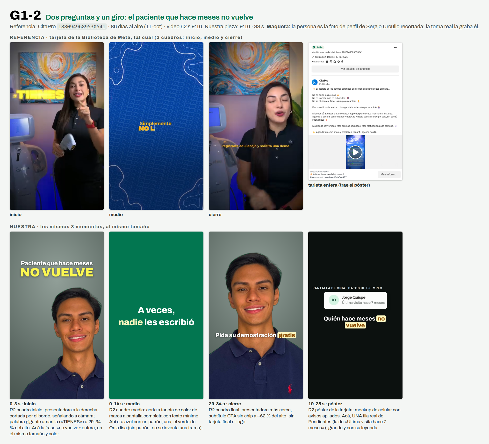

# G1-2 · Dos preguntas y un giro: el paciente que hace meses no vuelve

> **Prueba 1 v2 · 11-oct-2026 · Ventas y pauta.** Nada se creó en Meta, cero gasto, nadie contactado. Generado por `replica-hojas.mjs` desde `G1-2.json`: se edita el brief, no esta hoja.



**Referencia:** CitaPro `1880949689530541` · **86 días al aire** al 11-oct (antigüedad, no rendimiento) · video 62 s 9:16. Ficha zona por zona: `research/competencia/anuncios/replicas/REFERENCIAS-GRUPO-1.md` §R2.
**Nuestra pieza:** 9:16 · 33 s · código del chat `D8` · imágenes en `carousels/out/ads/prueba1-v2/G1-2/`.

## Zona por zona

| Zona | Referencia (lo que se ve en su captura) | Nuestra |
|---|---|---|
| **Inicio** | Presentadora a la derecha, cortada por el borde, señalando a cámara; palabra gigante amarilla («TIENES») a 29-34 % del alto. | Sergio a la derecha; «no vuelve» entero en amarillo gigante a ~25 % del alto (el gancho sigue en 2 líneas). |
| **Medio** | Corte seco a tarjeta azul con patrón; texto chico que se escribe solo. | Tarjeta verde de Onia, lisa (no se inventa una trama), con 2 líneas **más grandes** que la referencia para que se lean a 390 px. |
| **Final** | Presentadora más cerca, subtítulo CTA ámbar sin chip a 61-63 %; sin tarjeta final ni logo. | Sergio más cerca, subtítulo CTA con chip a ~65 %; sin tarjeta final. |
| **Póster** | Mockup de celular con avisos apilados. | UNA fila REAL de Pendientes; sin avisos inventados. |
| **Forma del copy** | «El secreto de… No es X, no es Y… Es Z.» (la fórmula que CitaPro repite en sus 3 anuncios). | Dos preguntas y un giro, con otras palabras: «¿Se enojaron? ¿Se fueron a otra clínica? A veces, nadie les escribió.» No usa «El secreto», ni «No es…», ni «simplemente» (la palabra de su tarjeta). |
| **Largo** | 62 s. | 33 s. |

## Gancho (checklist de §9.3)

- **Texto en pantalla:** «Paciente que hace meses / no vuelve» (2 líneas de 23 y 9 caracteres, sin punto final, un énfasis).
- **Se ve (cuadro 0):** Sergio Urcullo a la derecha del cuadro, de frente, señalando a cámara; en el tercio superior, el gancho de 2 líneas con la palabra «VUELVE» gigante en amarillo.
- **Se dice:** «Hay pacientes que hace meses no vuelven.»
- **Alinean sin repetirse:** La voz dice «hay pacientes que hace meses no vuelven», el texto gigante dice «Paciente que hace meses / no VUELVE» y la pantalla (19-25 s) muestra «Última visita hace 7 meses»: los tres dicen lo mismo con palabras distintas, no la misma frase.
- **Alternativa:** «Pacientes que se van / sin aviso»

## Guion

| Tramo | Toma | Se dice | En pantalla |
|---|---|---|---|
| 0-3 s | Sergio a la derecha del cuadro, señala a cámara; el gancho arriba con «VUELVE» gigante | Hay pacientes que hace meses no vuelven. | Paciente que hace meses / no *vuelve* (la palabra gigante, amarilla) |
| 3-9 s | Sergio a cámara, plano medio, luz de ventana | ¿Se enojaron? ¿Se fueron a otra clínica? | Subtítulos: ¿Se *enojaron*? / ¿Se fueron a otra *clínica*? |
| 9-14 s | Tarjeta verde de Onia a pantalla completa; el texto aparece palabra por palabra | A veces, nadie les escribió. | A veces, / *nadie* les escribió |
| 14-19 s | Vuelve Sergio a cámara | Soy Sergio Urcullo, de Onia. Onia es un sistema de gestión para clínicas dentales. | Soy Sergio Urcullo, de *Onia* |
| 19-25 s | Pantalla real de Pendientes a cuadro completo: las dos filas ampliadas, con la leyenda «Pantalla de Onia · datos de ejemplo» | Cada mañana revisa su agenda. Le deja anotado quién hace meses no vuelve, con el mensaje listo. | Quién hace meses *no vuelve* |
| 25-29 s | Sergio a cámara | Usted aprueba cada mensaje. | Usted aprueba *cada mensaje* |
| 29-34 s | Sergio a cámara, cierra sonriendo | Escríbanos por WhatsApp y pida su demostración gratis. | Pida su demostración *gratis* |

## El anuncio en Meta

Texto principal (la primera línea es el filtro):

```
Para dueños y dueñas de clínicas dentales de Santa Cruz.
Un paciente que deja de venir no avisa, y su hora en la agenda queda sin dueño sin que nadie lo note.
Onia es un sistema de gestión para clínicas dentales: en Pendientes, cada mañana le deja anotado quién hace meses no vuelve, con el mensaje listo.
Ningún mensaje de Pendientes sale sin que usted lo apruebe.
Escríbanos por WhatsApp y pida su demostración gratis.
```

- **Titular:** `Pida su demostración gratis` · **Botón:** «Enviar mensaje de WhatsApp» (un solo llamado, un solo destino) · **Texto precargado:** `Hola, vi el anuncio de Onia (D8). Tengo una clínica dental.`

## Modelar, no clonar

- **Se queda:** La alternancia presentadora → tarjeta de color de marca → presentadora más cerca; una palabra gigante en el tercio superior; cierre hablado sin tarjeta final.
- **Cambia:** La idea (leads que se enfrían → pacientes que dejan de venir sin que nadie les escriba), el mecanismo (Pendientes, no un asistente que responde WhatsApp), el nombre, los colores y el largo. Sin IA, sin «24/7», sin «sin intervención humana».

## Promesas: cada frase atada a su fila

| Frase | Fuente y estado | Filas que tienen que estar en ✅ |
|---|---|---|
| Cada mañana Onia revisa su agenda | CAT §8 frase 3 · ⬜ sin verificar: corre solo, falta el log del VPS | G-04 |
| Le deja anotado quién hace meses no vuelve | CAT §8 frase 3 (son reglas fijas) · ⬜ sin verificar: falta la cuenta demo | G-05 |
| Con el mensaje listo | CAT §8 frase 3 · ⬜ sin verificar: falta la cuenta demo | G-05 |
| Usted lo aprueba; ninguno sale sin su OK | CAT §8 frase 3 · ⬜ sin verificar: falta la cuenta demo. Ojo: el recordatorio de cita por correo (B-03) sale solo; la frase queda pegada al mensaje de Pendientes y no se amplía | G-01 |
| Onia es un sistema de gestión para clínicas dentales | CAT §4 · ⬜ sin verificar: falta la cuenta demo | B-01, C-02, D-01, E-01 |
| A veces nadie les escribió (diagnóstico del problema, no promesa del producto) | Texto del descarte; no depende de ninguna función de Onia. Se dice «a veces» y «no siempre» a propósito: no se afirma por qué se van los pacientes | — |
| Pida su demostración gratis | CTA fija del brief · 🟡 verificada solo en parte: la duración de la llamada no se dice porque la web y los mensajes no coinciden | L-04 |
| Un paciente que deja de venir no avisa; su hora queda sin dueño (texto principal) | Hecho del negocio del dueño; no es función de Onia ni promete un resultado. | — |
| Hay pacientes que hace meses no vuelven; no siempre se enojaron ni se fueron a otra clínica (voz y subtítulos) | Observación del problema del dueño; no es función de Onia ni dice por qué se van. Dice «no siempre» a propósito. | — |

## No dice

- No promete ningún resultado, cifra ni porcentaje.
- No dice que Onia haga volver a nadie: solo deja anotado a quién escribirle.
- No afirma por qué se van los pacientes: usa «no siempre» y «a veces».
- No nombra montos, planes ni ofertas económicas.
- No cuenta casos de uso ni dice quién usa Onia.
- No dice que el mensaje salga solo: queda listo y lo aprueba usted.
- No presenta la herramienta como algo más que reglas claras.
- No nombra temas fiscales ni avisos al paciente por otros canales.
- No dice cuánto dura la llamada de demostración.
- No nombra otras empresas ni copia ninguna frase de la referencia; solo toma su forma (dos descartes y un giro).
- No muestra el texto del mensaje al paciente ni el botón de envío de la pantalla.

## Lo que graba o fotografía Sergio Urcullo

- Grabar en vertical, de medio cuerpo, con fondo liso o de oficina y luz de ventana, ropa de calle sencilla, mirando a cámara y señalando a cámara en la primera frase (como la presentadora de la referencia).
- Decir el texto de corrido dos veces, de usted y con pausas cortas entre frases, para que la edición pueda poner la tarjeta palabra por palabra en el medio.
- La primera frase (Hay pacientes que hace meses no vuelven) va CON su cara: él en el cuadro, señalando; la pantalla de Onia entra recién a los 19 s.
- Grabar la última frase (la invitación) tres veces, mirando a cámara y sonriendo al terminar.
- No hace falta grabar la pantalla de Onia: se compone en edición.
- En el gancho, gesto neutro o serio (nada de sonrisa mientras se dice el dolor); sonreír recién en la invitación del final.
- Ropa lisa y sin logos ni marcas a la vista (el polo de la maqueta lleva un logo ajeno).

## Límites de esta maqueta

- La persona es la foto de perfil de Sergio Urcullo recortada (`references/marca-personal-sergio`/`ui-patterns/apple-editorial/logos/sergio-rembg.png`), solo para ver el layout. La toma real la graba y la autoriza él; su cara y su voz en un anuncio pasan por su sí y el de Leslie Mercado Moreno (CLAUDE.md).
- La pantalla de Onia es la captura del candidato del 30-sep (`briefs/assets/onia-1.0-dental-ads/candidato-20260930/pendientes-confirmador.png`), recortada a dos filas con los mismos píxeles. Se recaptura con la cuenta demo antes de subir. Las filas de arriba siguen ⬜ hasta mirarlas con esa cuenta.
- No se muestra el mensaje al paciente (está en voseo) ni el botón «Enviar yo mismo por WhatsApp» (G-03 🟡).
- Lo único que prueba la referencia es que lleva 86 días al aire; no cuánto rinde.
