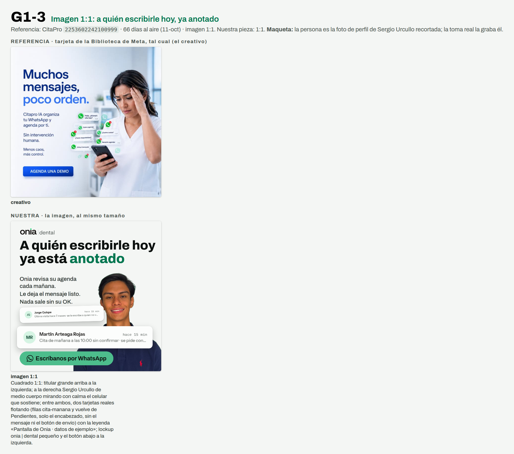

# G1-3 · Imagen 1:1: ¿quién de mañana no confirmó?

> **Prueba 1 v2 · 11-oct-2026 · Ventas y pauta.** Nada se creó en Meta, cero gasto, nadie contactado. Generado por `replica-hojas.mjs` desde `G1-3.json`: se edita el brief, no esta hoja.



**Referencia:** CitaPro `2253602242100999` · **66 días al aire** al 11-oct (antigüedad, no rendimiento) · imagen 1:1. Ficha zona por zona: `research/competencia/anuncios/replicas/REFERENCIAS-GRUPO-1.md` §R3. Apoyo: AgendaPro `3652876658196882` (64 d, 11-oct) repite la misma imagen: foto de profesional + burbujas de chat + «Agenda una demostración GRATIS». Dos anunciantes con el mismo formato.
**Nuestra pieza:** 1:1 · código del chat `D9` · imágenes en `carousels/out/ads/prueba1-v2/G1-3/`.

## Zona por zona

| Zona | Referencia (lo que se ve en su captura) | Nuestra |
|---|---|---|
| **Titular** | 3 líneas, tercio superior izquierdo (15-39 %), navy y un azul más claro en «poco orden.». | 2 líneas en la columna izquierda (≤ 17 caracteres cada una), la 2.ª con el énfasis en verde de Onia. Abre con el dolor, como R3. |
| **Bajada** | Tres bloques de tamaño decreciente (25 %, 25 %, 16 % del ancho). | Tres líneas del mismo tamaño (42 px, ≈ 15 px a 390). |
| **Persona** | Mujer agobiada a la derecha, cortada por el borde, mira el celular (≈ la mitad del cuadro). | Sergio a la derecha, cortado por el borde, ≈ 2/3 de la altura. **Maqueta:** mira a cámara y sonríe; la foto real lo muestra serio, mirando el celular. |
| **Burbujas** | 6 burbujas de chat de WhatsApp en la costura, textos de ellos. | UNA tarjeta **real** de Pendientes, grande (≈ 15 px a 390), cruzando la costura; ninguna burbuja inventada. |
| **Botón** | Dibujado a 80-86 % abajo a la izquierda, «AGENDA UNA DEMO». | Botón verde abajo a la izquierda, «Escríbanos por WhatsApp» (el único llamado). |
| **Marca** | Sin logo dentro del creativo. | Lockup `onia \| dental` chico arriba a la izquierda. |

## Gancho (checklist de §9.3)

- **Texto en pantalla:** «¿Quién de mañana / no confirmó?» (2 líneas de 16 y 12 caracteres, sin punto final, un énfasis).
- **Se ve (cuadro 0):** Cuadrado 1:1: titular en la columna izquierda; a la derecha Sergio Urcullo de medio cuerpo con el celular en la mano; cruzando la costura, UNA tarjeta real de Pendientes con «Cita de mañana a las 10:00 sin confirmar», con la leyenda «datos de ejemplo»; el botón abajo a la izquierda.
- **Alinean sin repetirse:** El titular pregunta quién de mañana no confirmó y la tarjeta real contesta con un caso («Cita de mañana a las 10:00 sin confirmar»); Sergio con el celular muestra de dónde sale. Sin voz: la imagen sola se lee en un segundo.
- **Alternativa:** «Su lista de la mañana / ya está hecha»

## El anuncio en Meta

Texto principal (la primera línea es el filtro):

```
Para dueños y dueñas de clínicas dentales de Santa Cruz.
Si nadie se acuerda de escribirle a un paciente, esa hora igual se paga: sillón, equipo y alquiler.
Onia es un sistema de gestión para clínicas dentales: en Pendientes, cada mañana le deja anotado quién tiene cita mañana y quién hace meses no vuelve, con el mensaje listo.
Ningún mensaje de Pendientes sale sin que usted lo apruebe.
Escríbanos por WhatsApp y pida su demostración gratis.
```

- **Titular:** `Pida su demostración gratis` · **Botón:** «Enviar mensaje de WhatsApp» (un solo llamado, un solo destino) · **Texto precargado:** `Hola, vi el anuncio de Onia (D9). Tengo una clínica dental.`

## Modelar, no clonar

- **Se queda:** Dos columnas con el texto a la izquierda y la persona a la derecha cortada por el borde, las tarjetas flotando en la costura, y el botón abajo a la izquierda.
- **Cambia:** El dolor (WhatsApp saturado → quién de mañana no confirmó), lo que flota (una fila real de la lista, no chats), el nombre, los colores y el titular a 2 líneas. Sin «IA», sin «sin intervención humana», sin «piloto automático». La cara de agobio de R3 NO se copia: Sergio no hace de dueño agobiado.

## Promesas: cada frase atada a su fila

| Frase | Fuente y estado | Filas que tienen que estar en ✅ |
|---|---|---|
| A quién escribirle hoy ya está anotado / Onia revisa su agenda cada mañana | CAT §8 frase 3 · ⬜ sin verificar: corre solo, falta el log del VPS | G-04, G-05, G-06 |
| Le deja el mensaje listo | CAT §8 frase 3 (son reglas fijas) · ⬜ sin verificar: falta la cuenta demo | G-05, G-06 |
| Usted aprueba cada mensaje (la bajada de la imagen) | CAT §8 frase 3 · ⬜ sin verificar: falta la cuenta demo. Ojo: el recordatorio de cita por correo (B-03) sale solo; la frase queda pegada al mensaje de Pendientes y no se amplía | G-01 |
| Tarjeta 1: cita de mañana sin confirmar (fila cita-manana) | Recorte real de Pendientes, captura del candidato del 30-sep · ⬜ sin verificar: falta la cuenta demo | G-06, B-02 |
| Tarjeta 2: quien hace meses no vuelve (fila vuelve) | Recorte real de Pendientes, captura del candidato del 30-sep · ⬜ sin verificar: falta la cuenta demo | G-05 |
| Onia es un sistema de gestión para clínicas dentales | CAT §4 · ⬜ sin verificar: falta la cuenta demo | B-01, C-02, D-01, E-01 |
| Pida su demostración gratis | CTA fija del brief · 🟡 verificada solo en parte: la duración de la llamada no se dice porque la web y los mensajes no coinciden | L-04 |
| Si nadie se acuerda de escribirle a un paciente, esa hora igual se paga (texto principal) | Hecho del negocio del dueño; no es función de Onia ni promete un resultado. | — |

## No dice

- No promete ningún resultado, cifra ni porcentaje.
- No inventa mensajes de chat ni burbujas: las dos tarjetas son filas reales de Pendientes.
- No nombra montos, planes ni ofertas económicas.
- No cuenta casos de uso ni dice quién usa Onia.
- No dice que el mensaje salga solo: queda listo y lo aprueba usted.
- No presenta la herramienta como algo más que reglas claras.
- No nombra temas fiscales ni avisos al paciente por otros canales.
- No dice cuánto dura la llamada de demostración.
- No nombra otras empresas ni copia frases de la referencia.
- No muestra el texto del mensaje al paciente ni el botón de envío de la pantalla.

## Lo que graba o fotografía Sergio Urcullo

- Fotografiar de medio cuerpo, a la derecha del encuadre, con luz de ventana y fondo claro y liso, mirando el celular que sostiene con las dos manos con gesto serio (no sonriendo a cámara); dejar libre la mitad izquierda de la foto.
- Sacar diez fotos: cinco mirando al celular y cinco mirando a cámara con gesto serio; en todas, ropa de calle lisa, sin bata y sin logos.
- Dejar la pantalla del celular apagada o en negro: la tarjeta con la lista se compone aparte.
- Entregar las fotos en vertical y en horizontal, sin filtros ni retoques y en la mejor resolución.

## Límites de esta maqueta

- La persona es la foto de perfil de Sergio Urcullo recortada (`references/marca-personal-sergio`/`ui-patterns/apple-editorial/logos/sergio-rembg.png`), solo para ver el layout. La toma real la graba y la autoriza él; su cara y su voz en un anuncio pasan por su sí y el de Leslie Mercado Moreno (CLAUDE.md).
- La pantalla de Onia es la captura del candidato del 30-sep (`briefs/assets/onia-1.0-dental-ads/candidato-20260930/pendientes-confirmador.png`), recortada a dos filas con los mismos píxeles. Se recaptura con la cuenta demo antes de subir. Las filas de arriba siguen ⬜ hasta mirarlas con esa cuenta.
- No se muestra el mensaje al paciente (está en voseo) ni el botón «Enviar yo mismo por WhatsApp» (G-03 🟡).
- Lo único que prueba la referencia es que lleva 66 días al aire; no cuánto rinde.
