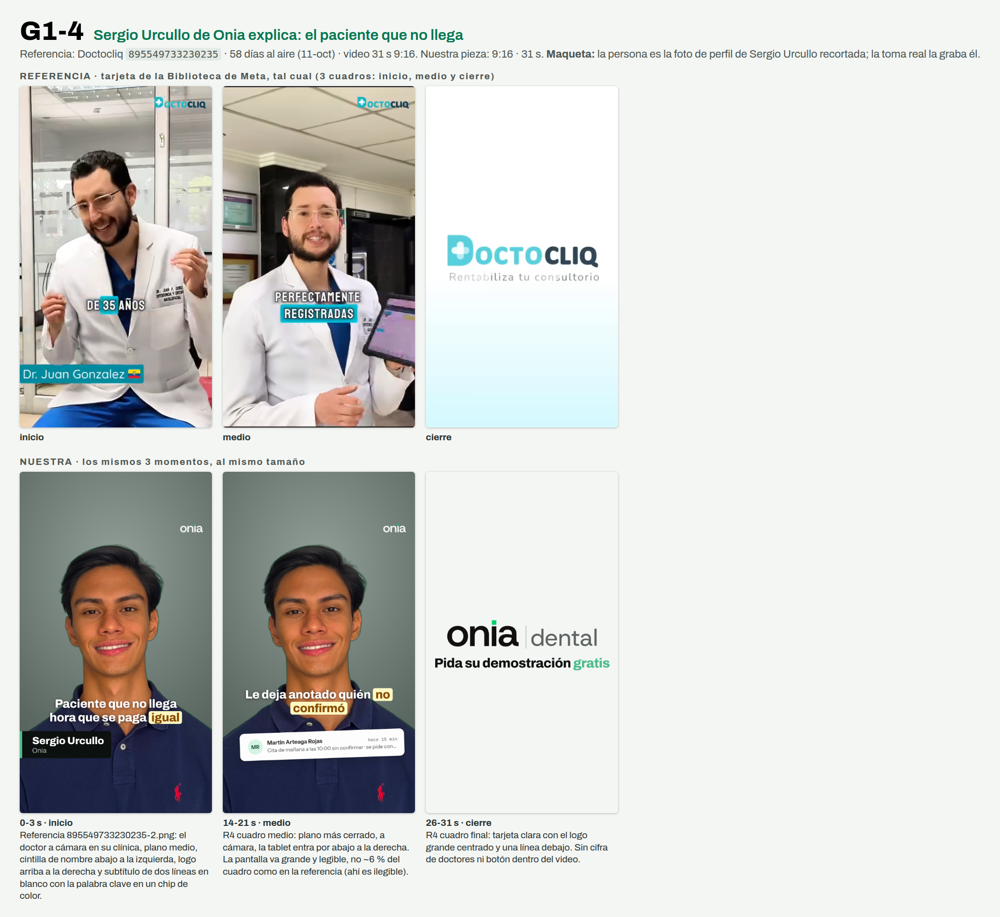

# G1-4 · Sergio Urcullo de Onia explica: el paciente que no llega

> **Prueba 1 v2 · 11-oct-2026 · Ventas y pauta.** Nada se creó en Meta, cero gasto, nadie contactado. Generado por `replica-hojas.mjs` desde `G1-4.json`: se edita el brief, no esta hoja.



**Referencia:** Doctocliq `895549733230235` · **58 días al aire** al 11-oct (antigüedad, no rendimiento) · video 31 s 9:16. Ficha zona por zona: `research/competencia/anuncios/replicas/REFERENCIAS-GRUPO-1.md` §R4. Apoyo: Doctocliq `1684698082830679` (55 d) confirma el patrón y muestra la pantalla real a cuadro completo.
**Nuestra pieza:** 9:16 · 31 s · código del chat `D10` · imágenes en `carousels/out/ads/prueba1-v2/G1-4/`.

## Zona por zona

| Zona | Referencia (lo que se ve en su captura) | Nuestra |
|---|---|---|
| **Logo** | Wordmark chico fijo arriba a la derecha (2,5-6,5 % del alto). | `onia` chico fijo arriba a la derecha, por debajo de los 270 px que Meta tapa en historias. |
| **Persona** | Doctor plano medio corto, ríe con las manos arriba; luego más cerca. | Sergio Urcullo plano medio. **Maqueta:** busto recortado. |
| **Subtítulo** | 2 líneas blancas, la palabra clave en un chip turquesa (60-69 %). | 2 líneas blancas, la palabra clave en el chip amarillo, debajo del mentón. |
| **Cintilla** | Pegada al borde izquierdo (81-87 %): «Dr. Juan Gonzalez» + bandera. | Pegada al borde izquierdo: **«Sergio Urcullo · Onia»**, su nombre real, sin cargo ni bandera. |
| **Producto** | Tablet en una esquina, ≈ 6 % del cuadro, pantalla ilegible. | La fila real de Pendientes, casi todo el ancho y legible. Lo contrario de la referencia, a propósito. |
| **Cierre** | Tarjeta blanca → celeste, logo grande + «Rentabiliza tu consultorio»; sin botón dentro del video. | Tarjeta clara con el logo grande + «Pida su demostración gratis»; sin cifra de doctores. |
| **Texto** | Dinero perdido + «hasta el 25 % de tus ingresos» + testimonio con nombre. | El sillón, el alquiler y el equipo se pagan igual; **sin cifra**. No es un testimonio: lo explica quien hace el producto. |

## Gancho (checklist de §9.3)

- **Texto en pantalla:** «Paciente que no llega / hora que se paga igual» (2 líneas de 21 y 22 caracteres, sin punto final, un énfasis).
- **Se ve (cuadro 0):** Sergio Urcullo en una oficina luminosa, plano medio, mirando a cámara, ropa de oficina; cintilla «Sergio Urcullo · Onia» abajo a la izquierda, logo onia | dental arriba a la derecha y el gancho en dos líneas blancas con la palabra igual en un chip de color.
- **Se dice:** «Venga o no el paciente, el sillón se paga.»
- **Alinean sin repetirse:** El texto nombra el costo (la hora que se paga igual), la voz lo baja a algo concreto (el sillón cuesta lo mismo) y la imagen es quien lo explica, con su nombre en la cintilla: tres capas de la misma idea sin repetir palabras.
- **Alternativa:** «Una hora sin paciente / se paga igual»

## Guion

| Tramo | Toma | Se dice | En pantalla |
|---|---|---|---|
| 0-3 s | Sergio a cámara en la oficina, plano medio, cintilla abajo a la izquierda | Venga o no el paciente, el sillón se paga. | Subtítulo de dos líneas: Paciente que no llega / hora que se paga *igual*; cintilla Sergio Urcullo · Onia; logo arriba a la derecha |
| 3-9 s | Misma toma | Soy Sergio Urcullo, de Onia. Es un sistema de gestión para clínicas dentales. | Subtítulo: Soy Sergio Urcullo, de *Onia* |
| 9-14 s | Sergio levanta la tablet hacia cámara | Cada mañana, Onia revisa su agenda. | Subtítulo: Cada mañana revisa su *agenda* |
| 14-21 s | La tablet con la fila de Pendientes se amplía a casi cuadro completo; Sergio arriba | Aquí, en Pendientes, le deja anotado quién no confirmó. Con el mensaje listo. | Fila cita-manana legible a 390 px de ancho (nunca el mensaje ni el botón de envío) con la leyenda «Pantalla de Onia · datos de ejemplo»; subtítulo: Le deja anotado quién *no confirmó* |
| 21-26 s | Vuelve Sergio a cámara | Usted lo revisa y lo aprueba. Nada sale sin su OK. | Subtítulo: Usted lo *aprueba* |
| 26-31 s | Tarjeta clara con el logo | Escríbanos por WhatsApp y pida su demostración gratis. | Tarjeta: onia \| dental / Pida su demostración *gratis* |

## El anuncio en Meta

Texto principal (la primera línea es el filtro):

```
Para dueños y dueñas de clínicas dentales de Santa Cruz.
Cuando un paciente no llega, el sillón, el alquiler y el equipo se pagan igual: es plata que no entra.
Soy Sergio Urcullo, de Onia, un sistema de gestión para clínicas dentales. En Pendientes, cada mañana le deja anotado a quién escribirle, con el mensaje listo.
Nada sale sin que usted lo apruebe.
Escríbanos por WhatsApp y pida su demostración gratis.
```

- **Titular:** `Pida su demostración gratis` · **Botón:** «Enviar mensaje de WhatsApp» (un solo llamado, un solo destino) · **Texto precargado:** `Hola, vi el anuncio de Onia (D10). Tengo una clínica dental.`

## Modelar, no clonar

- **Se queda:** Una persona con nombre en una cintilla pegada al borde, el logo fijo arriba a la derecha, subtítulos de dos líneas con palabra clave en chip, el producto en la segunda mitad y un cierre limpio con el logo.
- **Cambia:** Quién habla (no es un cliente ni un odontólogo: es Sergio Urcullo, sin cargo), el dolor sin cifra, el mecanismo (Pendientes), el nombre, los colores y el cierre (sin «+3500 doctores»).

## Promesas: cada frase atada a su fila

| Frase | Fuente y estado | Filas que tienen que estar en ✅ |
|---|---|---|
| Cada mañana Onia revisa su agenda | CAT §8 frase 3 · ⬜ sin verificar: corre solo, falta el log del VPS | G-04 |
| Le deja anotado quién no confirmó (la cita de mañana) | CAT §8 frase 3 (son reglas fijas) · ⬜ sin verificar: falta la cuenta demo | G-06, B-02 |
| Con el mensaje listo | CAT §8 frase 3 · ⬜ sin verificar: falta la cuenta demo | G-06 |
| Usted lo revisa y lo aprueba; nada sale sin su OK | CAT §8 frase 3 · ⬜ sin verificar: falta la cuenta demo. Ojo: el recordatorio de cita por correo (B-03) sale solo; la frase queda pegada al mensaje de Pendientes y no se amplía | G-01 |
| Onia es un sistema de gestión para clínicas dentales | CAT §4 · ⬜ sin verificar: falta la cuenta demo | B-01, C-02, D-01, E-01 |
| Cuando un paciente no llega, el sillón, el alquiler y el equipo se pagan igual | Hecho del negocio del dueño, no función de Onia; no promete que Onia evite que el paciente falte | — |
| Pida su demostración gratis | CTA fija del brief · 🟡 verificada solo en parte: la duración de la llamada no se dice porque la web y los mensajes no coinciden | L-04 |

## No dice

- No promete ningún resultado, cifra ni porcentaje: el costo del paciente que no llega se nombra como dolor, no como algo que Onia elimine.
- Sergio no dice que sea odontólogo ni que haya probado Onia en una clínica; habla solo como quien explica Onia.
- No nombra montos, planes ni ofertas económicas.
- No cuenta casos de uso ni dice quién usa Onia.
- No dice que el mensaje salga solo: queda listo y lo aprueba usted.
- No presenta la herramienta como algo más que reglas claras.
- No nombra temas fiscales ni avisos al paciente por otros canales.
- No dice cuánto dura la llamada de demostración.
- No nombra otras empresas ni copia frases de la referencia (ni su cifra de ingresos ni su historia de un doctor).
- No muestra el texto del mensaje al paciente ni el botón de envío de la pantalla.

## Lo que graba o fotografía Sergio Urcullo

- Grabar en vertical en una oficina luminosa o junto a una ventana, plano medio, mirando a cámara, con ropa de oficina y sin bata ni uniforme.
- Hablar como Sergio Urcullo, de Onia: su nombre, qué es el sistema y qué se ve en Pendientes; sin contar casos de nadie ni decir que lo usa una clínica.
- Tener una tablet a mano (si no hay, el celular) y sostenerla a la altura del pecho, inclinada hacia cámara, durante las frases de Pendientes; la pantalla real se pone en edición, ampliada.
- Decir el texto de corrido, de usted, y luego grabar tres veces la última frase (la invitación).
- Entregar la toma sin música; la tarjeta de cierre con el logo la arma la edición.

## Límites de esta maqueta

- La persona es la foto de perfil de Sergio Urcullo recortada (`references/marca-personal-sergio`/`ui-patterns/apple-editorial/logos/sergio-rembg.png`), solo para ver el layout. La toma real la graba y la autoriza él; su cara y su voz en un anuncio pasan por su sí y el de Leslie Mercado Moreno (CLAUDE.md).
- La pantalla de Onia es la captura del candidato del 30-sep (`briefs/assets/onia-1.0-dental-ads/candidato-20260930/pendientes-confirmador.png`), recortada a dos filas con los mismos píxeles. Se recaptura con la cuenta demo antes de subir. Las filas de arriba siguen ⬜ hasta mirarlas con esa cuenta.
- No se muestra el mensaje al paciente (está en voseo) ni el botón «Enviar yo mismo por WhatsApp» (G-03 🟡).
- Lo único que prueba la referencia es que lleva 58 días al aire; no cuánto rinde.
