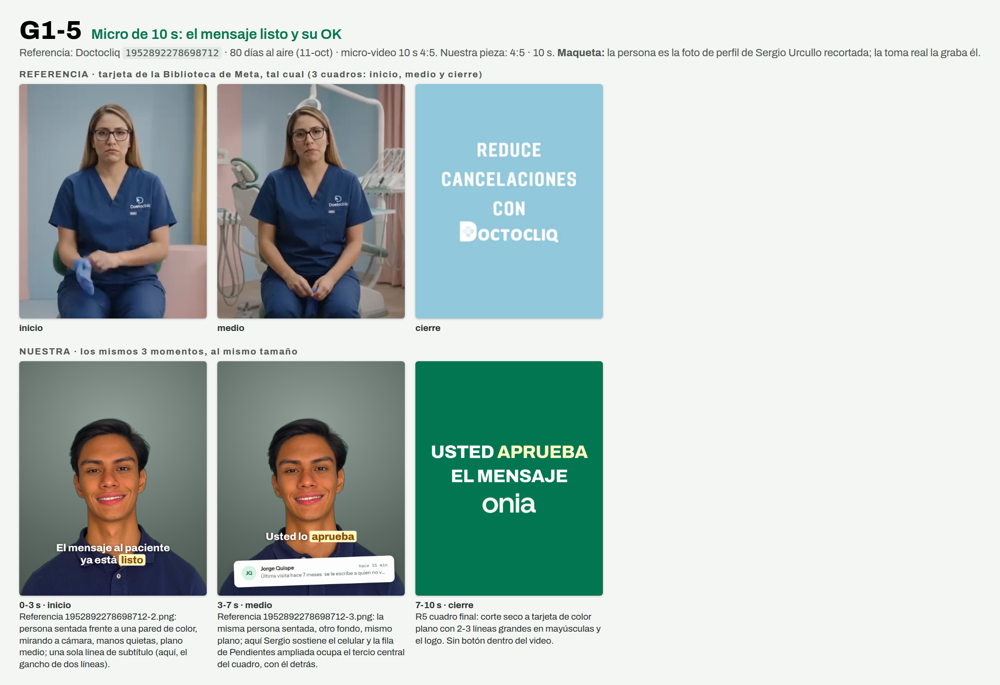

# G1-5 · Micro de 10 s: el mensaje listo y su OK

> **Prueba 1 v2 · 11-oct-2026 · Ventas y pauta.** Nada se creó en Meta, cero gasto, nadie contactado. Generado por `replica-hojas.mjs` desde `G1-5.json`: se edita el brief, no esta hoja.



**Referencia:** Doctocliq `1952892278698712` · **80 días al aire** al 11-oct (antigüedad, no rendimiento) · micro-video 10 s 4:5. Ficha zona por zona: `research/competencia/anuncios/replicas/REFERENCIAS-GRUPO-1.md` §R5. Apoyo: Doctocliq `1748838402916201` (85 d, 11-oct) es el mismo creativo con otro id: lo repiten.
**Nuestra pieza:** 4:5 · 10 s · código del chat `D11` · imágenes en `carousels/out/ads/prueba1-v2/G1-5/`.

## Zona por zona

| Zona | Referencia (lo que se ve en su captura) | Nuestra |
|---|---|---|
| **Persona** | Doctora sentada, frontal, plano americano, mira a cámara, cara en 9-36 % del alto; sin subtítulos en los cuadros vistos. | Sergio sentado, frontal, mirada a cámara. **Maqueta:** busto. **Cambia:** lleva subtítulo, porque el checklist del gancho pide el texto en pantalla. |
| **Medio** | Misma pose; el fondo cambia a consultorio. | Misma pose + la fila real de Pendientes, debajo del mentón. |
| **Cierre** | Corte seco a tarjeta celeste plana: «REDUCE / CANCELACIONES / CON» + logo blanco (4:5). | Corte seco a tarjeta verde plana: «USTED APRUEBA / EL MENSAJE» + logo blanco (4:5). |
| **Texto** | «Doctora, tu tiempo (y tu almuerzo) valen demasiado para que te cancelen a última hora.» | Otra idea: el mensaje al paciente ya listo y que lo aprueba usted. Sin almuerzo, sin «cancelen», sin resultado prometido. |
| **Largo** | 10,2 s. | 10 s. |

## Gancho (checklist de §9.3)

- **Texto en pantalla:** «El mensaje al paciente / ya está listo» (2 líneas de 22 y 13 caracteres, sin punto final, un énfasis).
- **Se ve (cuadro 0):** Sergio Urcullo sentado y quieto, mirando a cámara como en la referencia, con el celular en la mano a la altura del pecho y expresión serena; el gancho en dos líneas sobre la parte baja del cuadro.
- **Se dice:** «Onia le deja anotado a quién escribirle.»
- **Alinean sin repetirse:** El texto dice que el mensaje ya está listo, la voz dice a quién hay que escribirle y la imagen es alguien con el celular a punto de mostrarlo: texto y voz son dos mitades de la misma frase, no la misma frase.
- **Alternativa:** «Mensaje al paciente / listo para aprobar»

## Guion

| Tramo | Toma | Se dice | En pantalla |
|---|---|---|---|
| 0-3 s | Sergio sentado, quieto, mirando a cámara, celular en la mano a la altura del pecho | Onia le deja anotado a quién escribirle. | Gancho en dos líneas: El mensaje al paciente / ya está *listo* |
| 3-7 s | Sergio levanta el celular; la fila vuelve de Pendientes ampliada ocupa el tercio central, con él detrás | Cada mañana, con el mensaje listo. Usted lo aprueba. | Fila vuelve legible a 390 px de ancho (nunca el mensaje ni el botón de envío) con la leyenda «Pantalla de Onia · datos de ejemplo»; subtítulo de una línea: Usted lo *aprueba* |
| 7-10 s | Tarjeta final de color plano | Pida su demostración gratis. | Mayúsculas blancas: USTED APRUEBA / EL MENSAJE; logo onia \| dental; línea final: PIDA SU DEMOSTRACIÓN GRATIS |

## El anuncio en Meta

Texto principal (la primera línea es el filtro):

```
Para dueños y dueñas de clínicas dentales de Santa Cruz.
Escribirle a cada paciente, uno por uno, se come la hora más tranquila de la mañana, y esa hora se paga igual.
Onia es un sistema de gestión para clínicas dentales: en Pendientes, cada mañana le deja anotado a quién escribirle, con el mensaje listo.
Usted lo lee y lo aprueba; nada sale sin su OK.
Escríbanos por WhatsApp y pida su demostración gratis.
```

- **Titular:** `Pida su demostración gratis` · **Botón:** «Enviar mensaje de WhatsApp» (un solo llamado, un solo destino) · **Texto precargado:** `Hola, vi el anuncio de Onia (D11). Tengo una clínica dental.`

## Modelar, no clonar

- **Se queda:** Diez segundos, una persona quieta mirando a cámara, una sola idea y un corte seco a una tarjeta de color plano con el logo.
- **Cambia:** La idea (de la cancelación como resultado a un mecanismo: «el mensaje ya está listo y usted lo aprueba»), el nombre, los colores y la persona (Sergio, no una doctora generada).

## Promesas: cada frase atada a su fila

| Frase | Fuente y estado | Filas que tienen que estar en ✅ |
|---|---|---|
| Onia le deja anotado a quién escribirle, cada mañana | CAT §8 frase 3 · ⬜ sin verificar: corre solo, falta el log del VPS | G-04, G-05, G-06 |
| El mensaje al paciente ya está listo | CAT §8 frase 3 (son reglas fijas) · ⬜ sin verificar: falta la cuenta demo | G-05, G-06 |
| Usted aprueba el mensaje; nada sale sin su OK | CAT §8 frase 3 · ⬜ sin verificar: falta la cuenta demo. Ojo: el recordatorio de cita por correo (B-03) sale solo; en la tarjeta la frase se acota a «el mensaje» (el de Pendientes) y no dice «nada» a secas | G-01 |
| Onia es un sistema de gestión para clínicas dentales | CAT §4 · ⬜ sin verificar: falta la cuenta demo | B-01, C-02, D-01, E-01 |
| Pida su demostración gratis | CTA fija del brief · 🟡 verificada solo en parte: la duración de la llamada no se dice porque la web y los mensajes no coinciden | L-04 |

## No dice

- No promete ningún resultado, cifra ni porcentaje.
- No usa la idea de la referencia (el tiempo personal del doctor): la idea es el mensaje ya listo y la aprobación del dueño.
- No nombra montos, planes ni ofertas económicas.
- No cuenta casos de uso ni dice quién usa Onia.
- No dice que el mensaje salga solo: queda listo y lo aprueba usted.
- No presenta la herramienta como algo más que reglas claras.
- No nombra temas fiscales ni avisos al paciente por otros canales.
- No dice cuánto dura la llamada de demostración.
- No nombra otras empresas ni copia frases de la referencia.
- No muestra el texto del mensaje al paciente ni el botón de envío de la pantalla.

## Lo que graba o fotografía Sergio Urcullo

- Grabar en vertical o en 4:5, sentado y quieto frente a una pared lisa o una ventana, mirando a cámara con el celular en la mano a la altura del pecho y expresión serena.
- Grabar cinco veces la primera frase (Onia le deja anotado a quién escribirle), con ritmo pausado: es lo único que lleva su cara en los 10 s.
- Grabar tres veces la frase del segundo tramo, primero mirando el celular y al final a cámara.
- Si hay otra pared o ventana disponible, grabar una toma extra con otro fondo (la referencia cambia de fondo a mitad).
- La tarjeta final y el logo los pone la edición.

## Límites de esta maqueta

- La persona es la foto de perfil de Sergio Urcullo recortada (`references/marca-personal-sergio`/`ui-patterns/apple-editorial/logos/sergio-rembg.png`), solo para ver el layout. La toma real la graba y la autoriza él; su cara y su voz en un anuncio pasan por su sí y el de Leslie Mercado Moreno (CLAUDE.md).
- La pantalla de Onia es la captura del candidato del 30-sep (`briefs/assets/onia-1.0-dental-ads/candidato-20260930/pendientes-confirmador.png`), recortada a dos filas con los mismos píxeles. Se recaptura con la cuenta demo antes de subir. Las filas de arriba siguen ⬜ hasta mirarlas con esa cuenta.
- No se muestra el mensaje al paciente (está en voseo) ni el botón «Enviar yo mismo por WhatsApp» (G-03 🟡).
- Lo único que prueba la referencia es que lleva 80 días al aire; no cuánto rinde.
