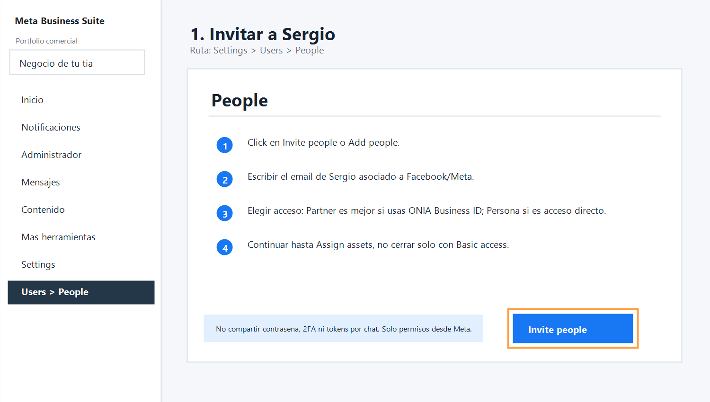
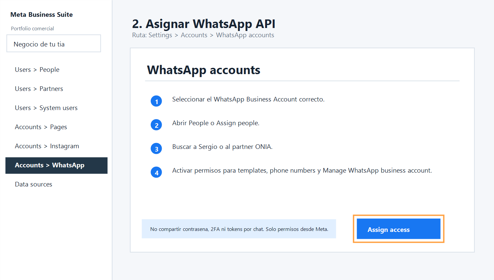
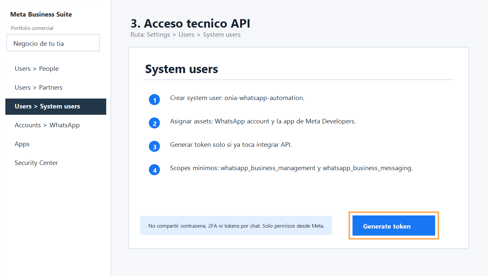

# Onia WhatsApp, Chatwoot, Meta y ventas - Auditoria 2026

Fecha: 2026-06-02

## Decision ejecutiva

Onia debe operar con un solo numero oficial de marca para entrada de clientes, confianza y continuidad comercial.

No conviene comprar un segundo numero oficial ahora.

La separacion correcta no es necesariamente por numero, sino por funcion:

- WhatsApp oficial Onia: recepcion, marca, inbound, calificacion, agenda y seguimiento.
- Chatwoot: bandeja multiagente cuando Cloud API este habilitada.
- Notion CRM: fuente de verdad para lead, vendedor origen, responsable actual, estado y comision.
- n8n: automatizacion interna, alertas, CRM, recordatorios, postventa y tareas.
- Vendedor: cierre humano, demo, negociacion y seguimiento autorizado.

Excepcion: si Onia hara prospeccion fria agresiva o entrenamiento de vendedores, conviene tener un numero/canal de prospeccion separado como sandbox operativo. Ese numero no debe presentarse como el WhatsApp oficial de Onia ni mezclar historial con clientes inbound.

## Estado actual verificado

Fuentes locales de Hermes y Notion confirman:

- Onia todavia no debe prometer ni activar WhatsApp automatico client-facing hasta verificacion Meta.
- El WhatsApp principal de Onia no debe ser un numero libre para todos los vendedores.
- Notion debe ser la fuente oficial para vendedores, estados, seguimientos y comisiones.
- Todo lead debe tener `vendedor_origen`, `responsable_actual`, estado pipeline, proximo seguimiento y datos completos.
- n8n no tiene todavia workflow activo para WhatsApp/Chatwoot Onia.

Fuentes revisadas:

- `CRM_AND_PROSPECTING.md`
- `hermes-content/docs/CRM_PROSPECTING.md`
- `hermes-content/docs/historial/skills/crm-prospeccion-onia.md`
- `NOTION_VENDOR_CRM_SCHEMA_2026.md`
- Notion: `CRM & Contactos`
- n8n: busqueda de workflows WhatsApp/Chatwoot/CRM Onia
- documentacion actual de Meta/WhatsApp y Chatwoot

## Respuesta a los puntos auditados

### 1. Un numero o dos numeros

Recomendacion:

Usar un unico numero oficial de Onia para inbound y marca. No comprar segundo numero oficial ahora.

Usar dos numeros solo si aparece uno de estos casos:

| Situacion | Decision |
|---|---|
| Equipo pequeno, marca en construccion, bajo volumen | Un numero oficial |
| Ventas inbound desde web, Instagram, referidos y ads | Un numero oficial con CRM |
| Vendedores necesitan prospectar en frio con volumen alto | Numero separado de prospeccion |
| Riesgo de spam, bloqueo o mala calidad por mensajes frios | Separar prospeccion del numero oficial |
| Meta no permite coexistencia para la configuracion real | Evaluar numero piloto antes de migrar oficial |
| Soporte postventa crece y ventas se vuelve caotico | Separar por inbox/equipo primero, numero despues |

Lectura final:

Un solo numero oficial es mejor para confianza y continuidad. Dos numeros solo se justifican para proteger reputacion, pruebas o prospeccion fria.

### 2. Limitaciones de coexistencia WhatsApp Business App + Cloud API

Meta ya tiene escenarios de coexistencia por Embedded Signup para conectar un numero existente de WhatsApp Business App a Cloud API y conservar uso uno-a-uno desde la app. Pero no debe asumirse como garantizado hasta probarlo en la cuenta real de Onia.

Limitaciones clave:

- Requiere flujo de Embedded Signup compatible.
- Requiere que el pais/codigo del numero sea soportado.
- Requiere app/partner/proveedor compatible con coexistencia.
- Requiere webhooks capaces de recibir eventos correctamente.
- Puede tener limites de throughput para numeros en coexistencia.
- Los mensajes por API tienen reglas, costos y ventanas distintas a la app.
- La disponibilidad real puede depender de cuenta, proveedor, pais, WABA, Business Manager y estado de verificacion.
- Chatwoot Cloud puede conectar WhatsApp Cloud API por Embedded Signup, pero la prueba real debe hacerse con la cuenta de Onia cuando exista NIT/verificacion.

Regla Onia:

No vender "coexistencia garantizada". Venderlo como fase tecnica verificable despues del NIT.

### 3. Flujo optimo Chatwoot + n8n

Arquitectura recomendada:

```text
Web / Instagram / Facebook Ads / Referidos
  -> WhatsApp oficial ONIA
  -> Chatwoot Cloud inbox WhatsApp
  -> AgentBot / n8n clasifica solo si bot_allowed=true
  -> Notion CRM crea o actualiza lead
  -> Si hay intencion de compra: handoff humano
  -> Chatwoot asigna vendedor/equipo
  -> Vendedor cierra
  -> n8n ejecuta seguimiento, tareas, recordatorios y postventa
```

Estados Chatwoot recomendados:

- `pending`: bot o calificacion inicial.
- `open`: humano debe responder.
- `snoozed`: seguimiento futuro.
- `resolved`: cerrado o sin accion inmediata.

Labels recomendados:

- `source_web`
- `source_instagram`
- `source_facebook_ads`
- `source_referido`
- `intent_demo`
- `intent_precio`
- `intent_soporte`
- `lead_calificado`
- `handoff_humano`
- `bot_pausado`
- `cliente_ganado`

Atributos recomendados:

- `lead_id`
- `vendedor_origen`
- `responsable_actual`
- `producto_interes`
- `ciudad`
- `rubro`
- `urgencia`
- `presupuesto_rango`
- `next_follow_up_at`
- `bot_allowed`
- `crm_status`
- `consentimiento_contacto`

### 4. Arquitectura de agencias similares

La arquitectura comun de agencias con ventas humanas y automatizacion es:

- Numero o canal oficial de marca para entrada.
- Inbox centralizado con asignaciones.
- CRM como fuente de verdad.
- Bot solo para primera capa y seguimiento simple.
- Humanos para venta, objeciones, propuesta y cierre.
- Automatizaciones internas para que el equipo no olvide nada.

En Onia, la version correcta es:

- Chatwoot no reemplaza CRM.
- Notion no reemplaza inbox.
- n8n no reemplaza vendedor.
- Bot no reemplaza cierre.

Cada herramienta debe hacer una parte.

### 5. Riesgos al migrar numero WhatsApp Business a Cloud API

Riesgos principales:

- Interrupcion temporal de atencion si la migracion falla.
- Confusion entre app, Cloud API, WABA y Business Manager.
- Restricciones por nombre comercial, verificacion o documentos.
- Necesidad de plantillas aprobadas para iniciar conversaciones fuera de ventana.
- Costos por mensajes API.
- Calidad del numero afectada si se hace outreach masivo.
- Historial y sincronizacion dependen del tipo de onboarding/coexistencia.
- Vendedores pierden acceso directo por dispositivos vinculados si se migra sin coexistencia.
- Dependencia de Chatwoot/proveedor para operacion diaria.

Mitigacion:

1. Formalizar empresa y verificar Meta.
2. Probar con numero piloto si es posible.
3. Documentar rollback antes de tocar el numero oficial.
4. Crear plantillas minimas antes de migrar.
5. Definir horarios, responsables y SLA.
6. Migrar solo cuando Chatwoot, Notion y n8n esten listos.

### 6. Como evitar que vendedores interfieran con el chatbot

Reglas operativas:

- Ningun vendedor responde desde el telefono fisico del numero oficial una vez que Chatwoot este activo.
- Toda conversacion debe tener un solo `responsable_actual`.
- Bot solo responde si `bot_allowed=true`, estado `pending` y no hay humano asignado.
- Cuando hay handoff, n8n/Chatwoot debe marcar `bot_pausado`.
- Si el humano escribe, el bot deja de responder salvo comandos internos.
- Notas internas obligatorias antes de reasignar.
- No hay descuentos, promesas tecnicas ni cambios de propuesta sin aprobacion.

Regla simple para el equipo:

```text
Bot califica. Vendedor cierra. CRM manda.
```

### 7. CRM y estructura de ventas para escalar

Fase inicial:

Usar Notion como CRM oficial, porque ya esta confirmado en Hermes y reduce costo.

Campos minimos:

- `lead_id`
- `empresa`
- `rubro`
- `ciudad`
- `contacto_publico`
- `fuente`
- `vendedor_origen`
- `responsable_actual`
- `estado_pipeline`
- `producto_sugerido`
- `ultimo_contacto`
- `proximo_seguimiento`
- `resultado_ultimo_contacto`
- `monto_cobrado`
- `comision_calculada`
- `comision_estado`
- `notas`

Pipeline recomendado:

- Nuevo
- Investigado
- Calificado
- Mensaje preparado
- Aprobado para contactar
- Contactado
- Respondio
- Demo agendada
- Demo realizada
- Propuesta enviada
- Ganado
- Perdido
- No apto

Cuando escale:

- Mantener Chatwoot como inbox.
- Mantener Notion si el volumen sigue manejable.
- Migrar a HubSpot/Pipedrive solo si aparecen reportes, forecasting, multiples vendedores y volumen que Notion ya no soporte.

### 8. Mejor practica 2026 para WhatsApp + IA + ventas humanas

La mejor practica actual no es un chatbot libre tipo asistente general.

La mejor practica es IA de negocio con alcance limitado:

- clasificar intencion;
- pedir datos minimos;
- responder FAQs aprobadas;
- agendar;
- crear o actualizar CRM;
- resumir conversacion;
- proponer siguiente accion;
- alertar a vendedores;
- hacer seguimiento con plantillas aprobadas;
- escalar a humano cuando hay compra, objecion, precio o excepcion.

Para Onia:

```text
IA como copiloto operativo, no como vendedor autonomo.
```

Esto tambien protege reputacion, cumplimiento y calidad del numero.

## Fases recomendadas

### Fase 1 - Ahora

Objetivo: vender ya sin esperar Meta.

- Usar WhatsApp Business manual del numero oficial Onia.
- Completar perfil empresarial.
- Crear catalogo o lista simple de servicios.
- Crear respuestas rapidas.
- Vincular maximo los dispositivos necesarios.
- Registrar todo lead en Notion.
- Definir vendedor origen y responsable actual.
- No automatizar WhatsApp client-facing.
- No hacer spam.

Accion comercial inmediata:

- Vendedores pueden prospectar por Instagram, LinkedIn, email o numero autorizado.
- WhatsApp oficial se usa con cuidado para inbound, referidos y conversaciones aprobadas.

### Fase 2 - Cuando salga el NIT

Objetivo: preparar operacion formal.

- Completar Business Manager.
- Verificar negocio en Meta.
- Revisar elegibilidad de WhatsApp Cloud API.
- Probar Embedded Signup con Chatwoot Cloud.
- Confirmar si coexistencia aplica al numero Onia.
- Crear plantillas WhatsApp basicas.
- Definir politicas de datos, acceso y roles.

### Fase 3 - Chatwoot + n8n + CRM

Objetivo: centralizar atencion y no perder leads.

- Crear inbox WhatsApp Cloud API en Chatwoot.
- Crear equipos: Ventas, Soporte, Sergio/Admin.
- Crear labels, atributos y reglas.
- Conectar webhooks Chatwoot -> n8n.
- n8n crea/actualiza Notion CRM.
- n8n avisa por Telegram.
- n8n agenda seguimientos.

### Fase 4 - IA controlada

Objetivo: mejorar velocidad sin perder control.

- Bot de calificacion.
- Resumen automatico para vendedor.
- Recomendacion de oferta Onia.
- Handoff humano.
- Seguimientos internos.
- Postventa y onboarding.

## Decision final para Onia

Recomendacion aprobable:

1. Mantener un unico numero oficial Onia.
2. No comprar segundo numero oficial por ahora.
3. Empezar ventas manuales hoy.
4. Registrar todo en Notion.
5. No activar WhatsApp automatico hasta NIT/verificacion Meta.
6. Cuando Meta este listo, probar Chatwoot Cloud + Cloud API.
7. Migrar el numero oficial solo con plan de prueba, handoff y rollback.
8. Si los vendedores haran prospeccion fria fuerte, crear un numero/canal de prospeccion separado y no mezclarlo con el numero oficial.

## Notion preparado

Fecha de preparacion: 2026-06-02

Se adapto la base existente `CRM & Contactos`, data source `collection://9b4c77be-d02b-4840-8f91-827ec8007839`, en vez de crear una base duplicada.

Campos agregados:

- control comercial: `Lead ID`, `Rubro`, `Ciudad`, `Pais`, `Web / perfil publico`, `Contacto publico`, `Canal principal`, `Fuente`, `Permiso de contacto`, `Vendedor origen`, `Responsable actual`;
- pipeline: `Estado pipeline`, `Producto sugerido`, `Prioridad`, `Dolor probable`, `Resultado ultimo contacto`, `Mensaje enviado`;
- cierre y comisiones: `Monto cobrado`, `Servicio vendido`, `Comision calculada`, `Estado comision`, `Fecha pago comision`, `Datos completos`;
- seguridad comercial: `No contactar`;
- WhatsApp/Chatwoot/IA: `Chatwoot conversation ID`, `Bot permitido`, `Bot pausado`, `WhatsApp etapa`.

Vistas creadas:

- `ONIA - Control principal`
- `ONIA - Pipeline ventas`
- `ONIA - Seguimientos`
- `ONIA - Aprobacion contacto`
- `ONIA - Comisiones pendientes`
- `ONIA - Datos incompletos`
- `ONIA - WhatsApp Chatwoot`
- `ONIA - Tiziana`
- `ONIA - Irene`
- `ONIA - Arthur`

Limpieza aplicada:

- la vista principal dejo de mostrar todas las columnas y ahora muestra solo los campos comerciales importantes;
- las vistas por vendedor filtran por `Responsable actual`;
- no se eliminaron columnas ni registros reales porque "basura" debe definirse con precision antes de borrar datos de Notion.

Regla de uso:

```text
SIN DATOS COMPLETOS, NO HAY COMISION APROBADA.
```

## Runbook rapido - Acceso Meta WhatsApp API

Fecha: 2026-06-26

Objetivo: guiar una llamada en vivo para que la duena del Business Portfolio de
Meta otorgue acceso a Sergio/ONIA sin compartir contrasenas, codigos 2FA ni
tokens por chat.

Estado verificado en esta sesion:

- Brave abrio Meta Business Suite con la cuenta Onia activa.
- La URL directa a settings redirigio a Inicio, por lo que el flujo mas seguro
  para la llamada es navegar por la UI: `Settings` / `Administrador` / menu
  lateral.
- Se conservaron capturas neutralizadas, no capturas reales de cuenta, para no
  guardar IDs ni datos privados.

Capturas de referencia:







### Opcion recomendada

Si Onia ya tiene Business Portfolio propio, pedir acceso como partner. Es mas
profesional y reversible que agregar el perfil personal de Sergio a todo el
negocio.

Flujo:

1. La duena entra a `Meta Business Suite`.
2. Selecciona el Business Portfolio correcto.
3. Abre `Settings` o `Administrador`.
4. Va a `Users` > `Partners`.
5. Click `Add` > `Give a partner access to your assets`.
6. Ingresa el Business ID de Onia.
7. Asigna solo los activos necesarios:
   - WhatsApp Business Account.
   - Meta app asociada, si ya existe.
   - Page/Instagram solo si el proyecto lo requiere.
8. Da permisos de administracion sobre el WhatsApp Business Account mientras se
   hace el setup tecnico.
9. Al terminar el setup, reducir permisos si ya no se necesita control total.

### Opcion rapida si no hay Business ID Onia

Agregar a Sergio como persona.

Flujo:

1. `Settings` > `Users` > `People`.
2. Click `Invite people` o `Add people`.
3. Ingresar el email de Sergio usado en Facebook/Meta.
4. Dar acceso temporal suficiente para configurar WhatsApp API.
5. En el paso `Assign assets`, seleccionar el WhatsApp Business Account.
6. Activar permisos para administrar cuenta, templates y phone numbers.
7. Confirmar la invitacion.

No cerrar el flujo despues de solo dar `Basic access`. Si no se asigna el
WhatsApp Business Account, Sergio podra entrar al portfolio pero no operar la
API.

### Permisos del WhatsApp Business Account

Ruta esperada:

```text
Settings > Accounts > WhatsApp accounts > [WABA] > People / Assign people
```

Asignar a Sergio u Onia:

- control para administrar el WhatsApp Business Account;
- acceso a phone numbers;
- acceso a message templates;
- acceso a la app de Meta Developers si se va a generar token o configurar
  webhooks.

### System user para integracion API

Crear system user solo cuando ya toque integrar API. Para la llamada inicial,
puede bastar con dejar a Sergio/ONIA con permisos para crearlo despues.

Ruta esperada:

```text
Settings > Users > System users
```

Pasos:

1. Crear system user con nombre claro: `onia-whatsapp-automation`.
2. Asignarle assets:
   - WhatsApp Business Account.
   - Meta app usada por la integracion.
3. Generar token solo si la integracion se hara en ese momento.
4. Usar permisos minimos:
   - `whatsapp_business_management`;
   - `whatsapp_business_messaging`;
   - `business_management` solo si el caso lo exige.
5. Guardar el token en gestor seguro o entorno secreto. No pegarlo en chat,
   docs, capturas ni repositorio.

### Guion para la reunion

Texto recomendado:

```text
Tia, no necesito tu contrasena ni tu codigo. Solo necesito que desde tu cuenta
me agregues permisos al Business Portfolio y al WhatsApp Business Account. Si
sale la opcion Partner, usamos el Business ID de ONIA. Si no, me invitas por mi
correo de Meta. Despues revisamos juntos que tenga acceso al WhatsApp account,
phone numbers, templates y system users. El token no lo vamos a compartir por
WhatsApp ni por chat.
```

### Checklist de cierre

- Sergio/ONIA aparece en `People` o `Partners`.
- El WhatsApp Business Account correcto esta asignado.
- Se ven phone numbers dentro de WhatsApp Manager.
- Se ven message templates o permisos para crearlas.
- `System users` esta disponible o existe `onia-whatsapp-automation`.
- No se compartio contrasena, codigo 2FA ni token.
- Si se dio full control temporal, dejar una tarea para reducir permisos despues
  del setup.

### URLs utiles

Estas rutas pueden redirigir segun version de Meta o permisos. Si redirigen a
Inicio, navegar por el menu lateral:

- Business settings: https://business.facebook.com/latest/settings/
- People: https://business.facebook.com/latest/settings/people
- Partners: https://business.facebook.com/latest/settings/partners
- WhatsApp accounts: https://business.facebook.com/latest/settings/whatsapp_account
- System users: https://business.facebook.com/latest/settings/system_users
- WhatsApp Manager: https://business.facebook.com/latest/whatsapp_manager
- Meta Developers apps: https://developers.facebook.com/apps/

## Fuentes externas revisadas

- Meta/WhatsApp Cloud API overview: https://developers.facebook.com/docs/whatsapp/cloud-api/
- Meta/WhatsApp Embedded Signup: https://developers.facebook.com/docs/whatsapp/embedded-signup/
- Meta Business Help - add people and assign assets: https://www.facebook.com/business/help/2169003770027706
- Meta Business Help - assign business assets to people: https://www.facebook.com/business/help/325571851329683
- Meta Business Help - give partner access to assets: https://www.facebook.com/business/help/1717412048538897
- Meta Business Help - add system users: https://www.facebook.com/business/help/503306463479099
- Meta for Developers - WhatsApp Cloud API get started: https://developers.facebook.com/documentation/business-messaging/whatsapp/get-started
- Meta for Developers - WhatsApp permissions: https://developers.facebook.com/documentation/business-messaging/whatsapp/permissions/
- Meta for Developers - WhatsApp access tokens: https://developers.facebook.com/documentation/business-messaging/whatsapp/access-tokens
- Meta/WhatsApp Business app onboarding/coexistence mirror de documentacion: https://support2.chatarchitect.com/books/meta-whatsapp/page/onboarding-whatsapp-business-app-users-aka-coexistence-developer-documentation
- Chatwoot WhatsApp Embedded Signup: https://www.chatwoot.com/hc/user-guide/articles/1752129193-how-to-use-whatsapp-embedded-signup
- Chatwoot Agent Bots: https://www.chatwoot.com/hc/user-guide/articles/1677497472-how-to-use-agent-bots
- Chatwoot Webhooks: https://www.chatwoot.com/docs/product/others/webhook-events
- Chatwoot WhatsApp templates: https://www.chatwoot.com/hc/user-guide/articles/1754940076-whatsapp-templates

Nota: la documentacion de coexistencia de Meta debe verificarse en el flujo real de Onia cuando exista NIT/verificacion. No convertir esta posibilidad en promesa comercial hasta probarla.

## Caso real aplicado - Bolivian Electric

Se documento el aprendizaje de acceso, verificacion Meta, mapeo S.R.L. -> `Empresa privada`, decision de numero unico, Chatwoot Cloud dedicado, n8n dedicado y reglas de handoff humano en:

- [BOLIVIAN_ELECTRIC_META_WHATSAPP_CASE_20260627.md](./historial/BOLIVIAN_ELECTRIC_META_WHATSAPP_CASE_20260627.md)

Usar ese caso como referencia operativa para clientes bolivianos con marca comercial distinta del nombre legal, numero actual en WhatsApp Business App y necesidad de preservar propiedad del portfolio en Meta.
