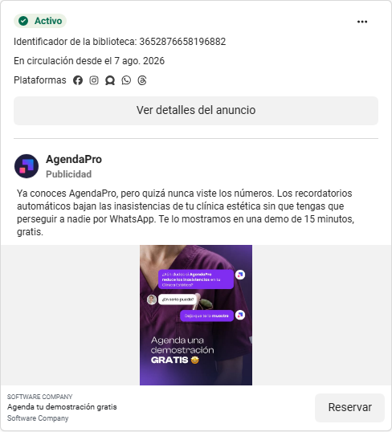
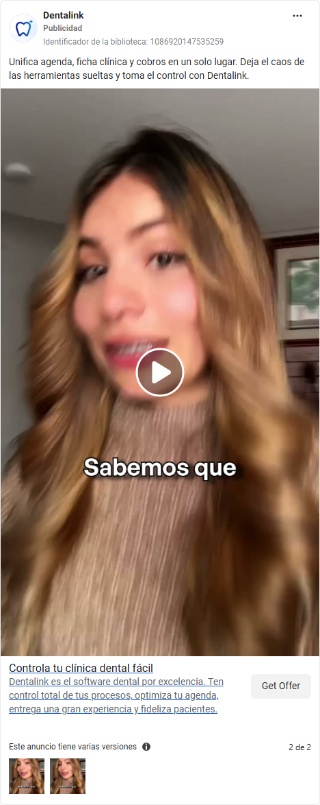

# Meta Ads y materiales de Anunciante Supremo aplicados a ONIA

Recepción y análisis: 12-oct-2026. Carril: Ventas y pauta. Encargo de Sergio Urcullo: estudiar fuentes y anuncios reales, aplicar lo aprendido y conservar evidencia con QA.

El aporte aplicable es filtrar al dueño de clínica, mantener alineados gancho, voz y visual, mostrar prueba legible del producto y cambiar una sola variable por comparación. Se aplicó este criterio a los cinco briefs G1 existentes. Sus funciones y aprobaciones siguen pendientes; este estudio no creó piezas ni campañas.

**META:** aprender de los dos Canva, cuatro transcripciones, HTML visible, ocho documentos del ZIP y capturas originales pertinentes al ICP. **PRUEBA:** citas por página/línea, cinco capturas vistas, aplicación a cinco briefs y recepción con hashes/QA. **PARADA:** sin ejecución de fuentes, instalaciones, generación, gasto, publicación, contacto, nuevos loops ni main/merge.

## Fuentes y alcance comprobado

| Fuente | Leído o visto | Límite |
|---|---|---|
| [Canva ejemplo](https://canva.link/ym441bmbtq330qk), diseño DAHXkRuKIyE | Texto de 4 páginas: PC en p1–2 y celular en p3–4 | Miniaturas disponibles como metadata; píxeles no inspeccionados. No se probaron botones, responsive o checkout |
| [Canva teoría](https://canva.link/eb84hhdmx328tha), diseño DAHXkrCCVN0 | Texto de 12 páginas; estructura p5, banner p6, soporte p7, testimonios p8, garantía p9, FAQ p10, pago p11 | Teoría y ejemplo no aportan datos de conversión ni prueba A/B |
| Dani, Franco, Rodrigo y Guilherme | Cuatro TXT completos en el texto delegado; líneas 5–279 del agregado | Transcripciones limpiadas, con términos dudosos marcados. No se escucharon los audios originales; cifras y capacidades del proveedor son declaraciones |
| Clase de diez skills | Texto visible del HTML, líneas 280–1074 | HTML no ejecutado; no implica que sus skills estén instaladas ni autorizadas |
| Anunciante Supremo 1.1.0 | README, LEEME, SKILL, hooks y cuatro plantillas; líneas 1075–2481 | Documentación estudiada como fuente inerte. No se ejecutó código ni se verificaron precios/API o renders de las plantillas |
| Cinco anuncios de tres anunciantes | Capturas originales de tarjetas de Meta vistas por este worker | Históricos: cuatro del 11-oct y uno del 2-oct. Son imágenes/preview; no reproducción completa de los videos ni Biblioteca viva |

Se usó `ONIA_CLIENTE_IDEAL.md` §1–2: clínica de Santa Cruz, empezando por dental, 2–6 profesionales y recepción. Los anuncios de estética son referencias adyacentes; ninguno demuestra por sí solo ciudad, tamaño o alcance al ICP. El catálogo y la tabla promesa/producto siguen mandando sobre lo que ONIA puede decir.

No hay herramienta Meta Ads Library disponible en este worker. La política de red es restringida y no lista Facebook; no se repitió el 403 conocido. Canva permitió texto/páginas con el enlace compartido; el fetch por ID rechazó acceso. No se reintentó por otro host ni se cambiaron permisos. Para renovar el estudio vivo, la dependencia precisa es un conector oficial de lectura o una exportación delegada de anuncios originales con URL, fecha, país/filtro y creativo completo; no cookies ni sesiones trasladadas.

## Qué muestran los anuncios originales

Las fechas de inicio pertenecen al registro histórico. **País desconocido en las cinco filas**: no se infiere desde moneda, idioma o ICP. “Activo” en una captura es el estado de esa captura, no el del 12-oct. La antigüedad no permite ordenar ganadores ni calcular ROAS.

| Anunciante y anuncio | Fechas de fuente | Creativo visto y gancho textual | Oferta y prueba | CTA y variantes |
|---|---|---|---|---|
| AgendaPro [1201810243016378](https://www.facebook.com/ads/library/?id=1201810243016378) | Captura 11-oct; inicio 21-jun-2026 | Preview vertical con una persona a cámara y textos sobre clínica de depilación. Copy abre con la pregunta sobre IA para ese rubro | Declara historial, zonas tratadas y WhatsApp automático. La tarjeta no demuestra funcionamiento o resultados | “Más información”; titular “La IA que organiza tu clínica”. Variantes del mismo anuncio no constatadas |
| AgendaPro [3652876658196882](https://www.facebook.com/ads/library/?id=3652876658196882) | Captura 11-oct; inicio 7-ago-2026 | Imagen con figura de profesional, uniforme morado y burbujas promocionales de chat | Declara reducción de inasistencias y demo gratis de 15 minutos. El chat gráfico no es prueba de cliente ni de reducción | “Reservar”; “Agenda tu demostración gratis”. Formato/ángulo diferente del anuncio anterior; no se afirma experimento controlado |
| Doctocliq [1738720983808867](https://www.facebook.com/ads/library/?id=1738720983808867) | Captura 11-oct; inicio 17-jul-2026 | Preview con un niño esperando frente a un plato/reloj; el copy habla de resolver todo a última hora | Declara agenda online, recordatorios y “miles de doctores”. Es una afirmación del anunciante; esta captura no prueba cifras o resultados | “Ver detalles”; “La agenda que trabaja contigo”. Duración 30 s declarada por la ficha, no reproducida aquí |
| Doctocliq [1748838402916201](https://www.facebook.com/ads/library/?id=1748838402916201) | Captura 11-oct; inicio 17-jul-2026 | Preview de una figura de profesional sentada. Copy: el tiempo y el almuerzo frente a cancelaciones | “Prueba Doctocliq hoy”; la tarjeta no fija precio ni condiciones de esa prueba. No identifica un testimonio real | “Ver detalles”; “Prueba Doctocliq ahora”. Ficha declara 10 s; el contraste con el anuncio anterior es descriptivo, no prueba de cuál rinde |
| Dentalink [1086920147535259](https://www.facebook.com/ads/library/?id=1086920147535259) | Captura 2-oct 00:34 UTC; inicio 30-sep-2026 | Preview a cámara con subtítulo “Sabemos que”; variante 2 abre el copy con agenda, ficha y cobros unificados | Oferta de software dental y control. En el frame visto no se observa una demostración de UI ni resultados. La duración 38 s viene del registro | “Get Offer”; “Controla tu clínica dental fácil”. La tarjeta muestra “2 de 2”: dos versiones de copy registradas, sin métricas comparativas |

Dentalink aquí es una captura anterior de **otro ID**. No sustituye el anuncio 1614658333653742 que falló en el lote del 11-oct. Las personas y escenas son observables; no se infiere que sean médicos reales, clientes, actores o generadas con IA desde una imagen.

Dos ejemplos de los píxeles inspeccionados, conservados previamente en el canon:

## Aprendizajes por fuente y decisiones para ONIA

| Fuente y cita | Qué establece | Uso concreto y límite |
|---|---|---|
| Franco, líneas 62–126: grupos réplica → formato → variaciones → ángulos | Describe su estrategia para infoproductos con compra web y renovaciones diarias | Separar las variables en la ficha de cada hipótesis. No adoptar cuatro campañas, el calendario día1–6 ni ROAS≥2: ONIA mide conversaciones calificadas/demos y sigue su prueba autorizada |
| Franco, líneas 64–68: ocho días y supuestas impresiones por MCP | Declara que longevidad prueba ventas y que el asistente conoce impresiones | No incorporado: ni antigüedad ni acceso a una tarjeta muestran beneficio, gasto o ROAS. Un “top5” requeriría criterios y datos verificables, no esa regla |
| Rodrigo, líneas 140–163, y Canva teoría p5–11 | Propone oferta, soporte, testimonio, condiciones, FAQ y ayuda de pago para reducir dudas | Usar como checklist de claridad del recorrido ya existente. No presentar aumento de conversión: Rodrigo admite no tener comparación antes/después en líneas 189–191 |
| Rodrigo, líneas 151–153; Canva ejemplo p2/p4 y teoría p8/p9 | Recomienda capturas de testimonio con IA; el ejemplo usa ancla de precio, ingresos y devolución; la teoría habla de no sentir riesgo | No incorporar testimonios fabricados, precios-ancla ajenos, ingreso en 30 días, garantía de siete días o “ningún riesgo”. Condiciones de ONIA se leen de sus fuentes y se validan; no se cambian por esta clase |
| Dani, líneas 12–42 | Declara países, comisiones, QR, retiros y disponibilidad de pasarelas; aconseja prefijo telefónico para pasar desapercibido | Solo estudiar fricción de pago local. Proveedores/fechas/comisiones no comprobados; no alta, integración, cambio de país ni simulación de procedencia |
| Guilherme, líneas 201–278 | Relata cobros QR y sus cifras de negocio; propone revisar límites operativos, margen y embudo | Registrar preguntas sobre reconciliación/pago real y capacidad, sin atribuir sus ingresos o ROAS a ONIA. “Tesavis [?]”, requisitos de NIT y cobro recurrente quedan declarados/dudosos, no capacidades verificadas |
| HTML, líneas 280–1074 | Mapea diez skills y un flujo de modelado, anuncio, medición, entrega y upsells | Conservar dependencias/entradas y gates de QA. No adoptar “sobrevive siete días = winner”, thresholds de escalado ni vender entregables inexistentes antes de producirlos |
| ZIP hooks, líneas 1304–1471 | Enseña sujeto, motivo para quedarse, claridad y alineación texto/voz/visual | Aplicado a cinco briefs G1. Números solo con evidencia propia; frecuencia entre anunciantes es hipótesis, no rendimiento. La fuente se contradice entre máximo dos líneas y hasta tres: no importar un límite como ley; comprobar legibilidad en render |
| ZIP plantilla2, líneas 1836–1845 y 2053–2069 | Distingue lectura del visual y afirma que mostrar una app/entregable inexistente también promete | Para ONIA, la prueba visual debe ser UI real del mismo caso/fecha, con tiempo de lectura. Un mockup o un frame de actor no demuestra función. El piso de 1,5 s es heurística de esa plantilla, no resultado medido para ONIA |
| ZIP plantillas1–4, líneas 1472–2481 | Describe B-roll, UGC cosido, plastilina y explicación en cuatro capítulos; reuso, QA y cachés | Extraer organización de assets, continuidad y QA antes del render. Reuso de material propio y con derechos; no instalar APIMART, copiar identidad/guiones/estética distintiva, generar cara/voz ni adoptar costos o tiempos de edición como actuales |

La música fija y los nueve SFX incluidos no acreditan licencia de uso. No se incorporaron. Los comandos, `doctor --fix`, claves, `--si`, publicación y permisos descritos en el ZIP/HTML permanecieron como texto de estudio.

## Revisión de las doce dimensiones

| Dimensión | Hallazgo y estado de evidencia | Regla transferible y límite |
|---|---|---|
| Patrones | Observado en tarjetas: avatar/problema → oferta → un CTA. Declarado en las clases: separar ángulo, formato y gancho | Registrar una variable por comparación; repetición o duración no demuestra eficacia |
| Colores y paleta | Vistos morado en AgendaPro y acento turquesa en Doctocliq; paleta Canva no vista | Mantener marca de ONIA; no copiar identidad ni deducir códigos hex desde miniaturas |
| Tipografía | Texto blanco destacado/subtítulos en previews; familia/tamaños exactos desconocidos. Las plantillas declaran Inter/Arial y valores | Comprobar legibilidad real en móvil; documentación de plantilla no demuestra fuente renderizada |
| Edición y montaje | No se reprodujeron videos completos. ZIP declara velocidades, anclas por palabra y cortes | Voz real/capturas/EDL como base futura; no convertir 1,5/3/4,8 s o factores de velocidad en límites universales |
| Estilo visual | Vistos persona a cámara, escena cotidiana y gráfico de chat; origen real/IA no probado | El contexto debe corresponder al oficio; evitar que un recurso ilustrativo se confunda con evidencia de producto/cliente |
| Estructura de contenido | Texto de 16 páginas Canva y cuatro clases muestra oferta/ayuda/condiciones; tarjetas muestran un destino | Hacer coherente anuncio → siguiente paso existente. El flujo compra-web de un curso no define el embudo de demo SaaS |
| Guion y gancho | Sujeto/resultado/claridad declarados en hooks; tarjetas usan problema específico o categoría | Revisar juntos texto, voz y primer cuadro; prueba temprano solo si existe y se puede leer |
| Idioma y tono | Fuentes mezclan tú/vos y portugués contextual; producto ONIA exige usted | Adaptar criterio al ICP, sin copiar frases, promesas o cifras. Marca personal conserva su propio registro |
| UI y UX | Canva es referencia textual; clicks/responsive no probados. La imagen de checkout no prueba funcionamiento | Auditar claridad de alcance, ayuda, condiciones y pago en una tarea de UI autorizada; no afirmar mejora de conversión |
| Frontend | ZIP/HTML describen pipelines/campos; código no ejecutado. UI de checkout no inspeccionada | No instalar ni portar stack por esta lectura; continuidad técnica queda como documentación declarada |
| Backend y arquitectura | Pasarelas, reconciliación y autoentrega son declaraciones de terceros | Pedir evidencia propia antes de prometer automatización. No activar scripts, pagos, cuentas o nuevos proveedores |
| Negocio y oferta | ICP canónico y límites de funciones/CTA propios contrastados con ejemplos de infoproductos | Métrica de ONIA: conversación calificada y demo; conservar precios/condiciones canónicos y gates G05/G06/G01/G04 |

## Aplicación ya realizada a los briefs existentes

**Estado: aplicado y revisado documentalmente**, sin render nuevo, registro de voz ni efecto comercial probado. Se leyeron los cinco JSON existentes; no se modificaron. La prueba recuperable es `APLICACION-5-BRIEFS.json`.

| Brief | Lo observado en el documento | Acción de revisión antes de reutilizar |
|---|---|---|
| G1-1 | Voz dice clínica dental; texto habla de mañana sin confirmar; primer visual descrito es una persona al aire libre con teléfono | Comprobar filtro ICP en cuadro0 y prueba de agenda/Pendientes. El teléfono aislado no identifica el mecanismo; no dar por validada la alineación visual por una descripción |
| G1-2 | Hook sobre quien hace meses no vuelve y voz con la misma idea; la prueba UI está planificada más adelante | Comprobar que el caso realmente cumple G05 y no tiene futura cita; mantener fuera hasta prueba. No inventar diagnóstico o reactivación conseguida |
| G1-3 | Estático con una tarjeta planificada de Pendientes y “datos de ejemplo” | Es el mecanismo más explícito del plan, no evidencia funcional aún. Recapturar caso actual/legible después del gate; no usar captura vieja para acreditar hoy |
| G1-4 | Dolor económico del sillón/horario; persona y logo dental descritos | Conservar foco operativo y prueba propia. No volver ese dolor en porcentaje de ingresos recuperados ni garantía de ausencia de faltas |
| G1-5 | Texto nombra agenda de mañana; voz pregunta si vienen; visual descrito es una persona con teléfono | Verificar rubro/filtro legible al inicio y ancla de UI. Revisar acuerdo entre copy sobre tiempo de escribir y apertura sobre asistencia: son dolores próximos, no idénticos |

En los cinco, el texto principal filtra a dueños de clínicas dentales de Santa Cruz y el CTA existente es demostración gratis. Eso está observado en los briefs, **no prueba** el filtro del video renderizado o la operatividad de la demo. Cuatro dependen de G06 y G1-2 de G05; “sale” en el archivo es selección editorial, no aprobación.

## Acciones concretas y estado

1. **Hecho:** separar observación, declaración, inferencia y propuesta en esta ficha; identificar prueba/CTA/variantes de cinco tarjetas y país desconocido. No recontar el estudio de 271/417 ni fabricar un ranking de ganadores.
2. **Hecho:** aplicar alineación, filtro y prueba visual a los cinco briefs. La revisión señala puntos a comprobar; no crea cinco piezas ni altera las aprobaciones.
3. **Método a incorporar en `onia-ventas-pauta`:** mapa de una variable, prueba legible y correspondencia anuncio → destino; rechazos de longevidad=winners, testimonios IA y adopción automática de providers/skills.
4. **Dependencia real:** demo/UI actuales y prueba G05/G06/G01/G04. El ensayo en memoria reportado por Platform no sustituye esa prueba. El requerimiento técnico ya existe; no se duplicó ni se repitió el 403.
5. **Propuesta posterior, con autorización de su tarea:** revisar un recorrido de pago existente por claridad de alcance, condiciones, ayuda y errores. No rediseñar ni agregar una pasarela a partir de testimonios del curso.
6. **Para una prueba comercial futura aprobada:** fijar un concepto y cambiar un eje, con mensaje/oferta/destino constantes; registrar conversación calificada y demo. No añadir diariamente anuncios/campañas por la receta de un infoproducto ni atribuir ROAS sin datos propios.

## Recepción y trazabilidad

Texto agregado: **158282 bytes**, SHA256 `9d6b1d425a9d5eead22ce631d15097aa1bd0c9abde906d997fa5ce9754da6be2`, coincide con origen. ZIP original: **4182555 bytes**, SHA256 `c85b8c4e25c89aaba6c62df190d59b7e509d44bb4905da569432909f50aea4dc`, coincide; CRC PASS, **89 archivos**, sin rutas inseguras ni symlinks. Manifiesto de origen: 1100 bytes, seis entradas, JSON abierto. Los cuatro TXT y HTML fueron leídos en el agregado; no se afirma recuperación byte a byte de esos cinco originales individuales. Fuentes privadas/raw y URLs firmadas no se exportan en esta ficha.

Capturas/briefs: fuente Git `claude/onia-ventas-pauta-rmdv5j` commit `1f72b73c128f67d21ef3cfbe1614125a84fc522f`; metadatos/blobs y SHA256 cotejados. Canvafetch por ID denegado y lectura por enlace compartido exitosa se distinguen en el registro; no se cambió sharing.

Equipo real: `/root/manifest_rutas`, Luna configurado, recuperación de capturas y QA de recepción; `/root/claims_qa`, Sol6.1 medio configurado, lectura Canva/HTML y QA independiente del informe. No hay telemetría independiente del modelo efectivo. Madre Marketing coordina/revisa; este worker estudia y aplica.

**QA final: PASS.** Revisión independiente de `/root/claims_qa` sobre ficha, aplicación a cinco briefs y delta 9.10; tres correcciones de citas/alineación incorporadas. Cotejo de 25 campos de briefs PASS; recepción verificada por `/root/manifest_rutas`. Los límites de acceso y de prueba funcional permanecen abiertos.
